# Tripmate — Personas và User Journeys

**Mục đích:** Mô tả những người sẽ dùng Tripmate, hoàn cảnh sử dụng và các khoảnh khắc quyết định cần được thiết kế tốt trước khi đặc tả màn hình và yêu cầu chức năng.

**Phiên bản:** 0.1

**Cập nhật lần cuối:** 2026-11-17

**Tóm tắt:** Ba persona cốt lõi của Tripmate không có cùng động lực: người tổ chức cần giảm việc điều phối, thành viên thụ động cần tham gia với ít nỗ lực, còn người ngại nói chuyện tiền cần một cách ghi và thanh toán minh bạch nhưng không gây áp lực xã hội. Journey tốt phải đưa cả ba người từ một invite link đến việc cùng sử dụng trip mà không bắt họ học một công cụ phức tạp.

## 1. Phạm vi và giả định nghiên cứu

Tài liệu này dùng các giả định ban đầu trong [Product Brief](./01-product-brief.md): nhóm ưu tiên là 3–10 người, sử dụng VND, mobile-first, anonymous join và không cần cài app.

| ID | Giả định | Cách kiểm chứng |
|---|---|---|
| UXA-01 | Phần lớn người được mời mở link trên điện thoại từ Messenger/Zalo, không phải từ desktop. | Test kín bằng link thật trên iOS Safari và Android Chrome. |
| UXA-02 | Một người thường khởi tạo trip và kéo những người còn lại vào; không phải mọi thành viên đều chủ động ngang nhau. | Đo tỷ lệ action theo creator/member trong pilot. |
| UXA-03 | Nhóm sẵn sàng dùng app cho quyết toán nếu nhìn thấy công thức chia và số tiền phải trả rõ ràng. | Phỏng vấn sau khi mỗi nhóm xử lý ít nhất 3 expense. |
| UXA-04 | Thành viên mới không muốn tạo tài khoản cho một chuyến đi duy nhất. | Đo tỷ lệ hoàn tất join trước và sau khi có anonymous flow. |
| UXA-05 | Người dùng có thể chấp nhận notification nhẹ qua link/realtime, nhưng không muốn spam. | Hỏi tần suất mong muốn trong pilot; MVP ưu tiên in-app status và chia sẻ thủ công. |
| UXA-06 | “Chốt kèo” là một mốc xã hội: sau khi chốt, thay đổi cần có lý do và hiển thị cho cả nhóm. | Quan sát các thay đổi poll/date trong test nhóm. |

## 2. Persona 1 — Người tổ chức: Linh

| Thuộc tính | Chi tiết |
|---|---|
| Tên đại diện | Nguyễn Khánh Linh |
| Tuổi | 27 |
| Nghề nghiệp | Account Executive tại agency ở TP.HCM |
| Nhóm điển hình | 5–7 người bạn đại học, thỉnh thoảng rủ thêm người yêu/bạn của bạn |
| Thiết bị và thói quen | iPhone; dùng Messenger/Zalo liên tục; quen Google Maps và Google Sheets; thường làm việc trên điện thoại vào buổi tối |
| Tần suất đi chơi | Một chuyến ngắn mỗi 1–2 tháng; 1–2 chuyến lớn mỗi năm |
| Hành vi hiện tại | Tạo group chat, đưa 2–3 gợi ý, tạo poll thủ công, copy lịch vào note, cuối chuyến tự tính tiền bằng máy tính/Excel |
| Nỗi đau lớn nhất | Là đầu mối cho mọi câu hỏi: ai đi, đi ngày nào, ở đâu, ai đã trả bao nhiêu và còn thiếu ai |
| Điều khiến Linh tin tưởng | Có một nguồn thông tin chính, ai sửa gì nhìn thấy được, breakdown tiền có thể giải thích bằng một ảnh chụp màn hình |
| Kỳ vọng với Tripmate | Tạo trip trong dưới 2 phút; mời mọi người bằng một link; thấy ngay ai chưa tham gia; khóa kết quả; không phải nhập lại dữ liệu ở nhiều màn hình |
| Nỗi sợ/rào cản | Nhóm vẫn bỏ qua app để quay lại chat; anonymous session khiến Linh mất quyền kiểm soát; settlement sai làm mất uy tín với bạn bè |

### Jobs to be done của Linh

1. **Khi nhóm mới nảy ra ý tưởng đi chơi**, Linh muốn tạo một không gian chung và gửi link ngay để biến cuộc trò chuyện thành một quyết định có thể theo dõi.
2. **Khi nhiều người có lịch khác nhau**, Linh muốn nhìn được kết quả vote mà không phải tổng hợp từng tin nhắn.
3. **Khi chuyến đi kết thúc**, Linh muốn có danh sách chuyển khoản tối thiểu và giải thích được vì sao mỗi người phải trả số đó.

### Tiêu chí thành công của persona

| ID | Kết quả mong muốn | Chỉ báo hành vi |
|---|---|---|
| PER-01 | Tạo được trip và gửi invite trong một phiên liên tục | `trip_created` → `invite_shared` trong ≤3 phút. |
| PER-02 | Biết trạng thái tham gia của nhóm mà không nhắn riêng | Mở màn hình members và thấy trạng thái joined/pending. |
| PER-03 | Chốt được ít nhất một quyết định quan trọng | Có poll với trạng thái locked và kết quả hiển thị cho cả nhóm. |
| PER-04 | Không trở thành kế toán duy nhất | Các thành viên tự thêm expense; Linh chỉ review exception. |
| PER-05 | Đóng chuyến đi mà không tranh cãi công thức | Tất cả transfer có trạng thái; có thể xem breakdown từ net balance đến transfer. |

## 3. Persona 2 — Thành viên thụ động: Minh

| Thuộc tính | Chi tiết |
|---|---|
| Tên đại diện | Trần Quốc Minh |
| Tuổi | 25 |
| Nghề nghiệp | Software Engineer |
| Nhóm điển hình | Bạn đại học; thường được thêm vào sau khi người khác đã bàn gần xong |
| Thiết bị và thói quen | Android; đọc chat nhiều hơn viết; hay mở link từ notification; không thích đăng ký dịch vụ mới |
| Tần suất đi chơi | Tham gia 3–5 chuyến/năm, không phải người khởi xướng |
| Hành vi hiện tại | React tin nhắn hoặc trả lời “ok”; thường bỏ qua spreadsheet; chỉ hỏi lại khi gần ngày đi |
| Nỗi đau lớn nhất | Không muốn đọc 200 tin nhắn để biết lịch tập trung, phần mình phải trả và cần mang gì |
| Điều khiến Minh tin tưởng | Trang tóm tắt ngắn, trạng thái rõ, không có form dài; có thể tham gia mà không bị hỏi email/ảnh đại diện |
| Kỳ vọng với Tripmate | Mở link là biết trip nào, ngày nào, ai đi; vote một chạm; xem itinerary theo ngày; nhận đúng số tiền cần chuyển |
| Nỗi sợ/rào cản | Bấm nhầm làm thay đổi lựa chọn của nhóm; bị gắn vào chi phí mình không dùng; không biết display name có bị trùng |

### Jobs to be done của Minh

1. **Khi nhận invite**, Minh muốn biết link an toàn và trip có liên quan đến mình trước khi tham gia.
2. **Khi nhóm hỏi ý kiến**, Minh muốn chọn trong vài giây và biết lựa chọn của mình đã được ghi nhận.
3. **Khi cần thanh toán**, Minh muốn thấy một yêu cầu cụ thể: chuyển cho ai, bao nhiêu, nội dung gì; không phải tự suy luận từ tổng chi phí.

### Tiêu chí thành công của persona

| ID | Kết quả mong muốn | Chỉ báo hành vi |
|---|---|---|
| PER-06 | Join mà không cần onboarding dài | Invite open → display name → trip summary trong ≤60 giây. |
| PER-07 | Tham gia ít nhất một quyết định | Vote được lưu và có trạng thái “Bạn đã bình chọn”. |
| PER-08 | Xem được thông tin quan trọng không cần đọc chat | Trang overview hiển thị ngày, điểm đến, members và số dư của Minh. |
| PER-09 | Không bị tính nhầm khoản không tham gia | Trước khi lưu expense, danh sách participants hiển thị rõ và cho phép bỏ chọn. |
| PER-10 | Có thể hoàn tất trách nhiệm tài chính | Minh xem được transfer đến người nhận, copy nội dung và đánh dấu đã trả. |

## 4. Persona 3 — Người ngại nói chuyện tiền: Huyền

| Thuộc tính | Chi tiết |
|---|---|
| Tên đại diện | Phạm Ngọc Huyền |
| Tuổi | 31 |
| Nghề nghiệp | Marketing Manager |
| Nhóm điển hình | Nhóm bạn thân hoặc gia đình mở rộng; thường trả tiền trước cho đặt phòng/đặt xe nhưng không muốn nhắc nợ |
| Thiết bị và thói quen | iPhone/Android tùy chuyến; chụp hóa đơn; dùng ngân hàng số; ưu tiên thao tác riêng tư, không muốn số tài khoản xuất hiện công khai trong group |
| Tần suất đi chơi | 2–4 chuyến/năm; giá trị chi phí mỗi chuyến tương đối cao |
| Hành vi hiện tại | Ghi hóa đơn vào note hoặc gửi ảnh vào chat; cuối chuyến nhờ một người “tính giúp”; đôi khi bỏ qua khoản nhỏ để tránh phiền |
| Nỗi đau lớn nhất | Nói về nợ tiền khiến quan hệ khó xử; không chắc mình đang phải thu hay phải trả; khó giải thích khi chia không đều |
| Điều khiến Huyền tin tưởng | App dùng ngôn ngữ trung tính, không gọi ai là “con nợ”; hiển thị công thức; cho phép xác nhận riêng; QR che thông tin cho đến khi cần |
| Kỳ vọng với Tripmate | Nhập khoản chi trong lúc phát sinh; chọn đúng người tham gia; thấy net balance; gửi yêu cầu thanh toán lịch sự; biết khi nào đã khép sổ |
| Nỗi sợ/rào cản | QR hoặc số tài khoản bị lưu/log/chia sẻ; ai đó sửa expense sau khi đã thanh toán; app tự đánh dấu “đã trả” dù ngân hàng chưa chuyển thành công |

### Jobs to be done của Huyền

1. **Khi Huyền trả tiền thay nhóm**, muốn ghi nhận ngay khoản chi và người chịu phần để không phải nhớ lại sau chuyến đi.
2. **Khi cách chia không đều**, muốn thấy một breakdown đủ đơn giản để cả nhóm kiểm tra mà không cần tranh luận về công thức.
3. **Khi quyết toán**, muốn app đề xuất ít transfer và hỗ trợ VietQR/copy nội dung, nhưng quyền xác nhận thanh toán vẫn thuộc về con người.

### Tiêu chí thành công của persona

| ID | Kết quả mong muốn | Chỉ báo hành vi |
|---|---|---|
| PER-11 | Ghi expense mà không cần mở spreadsheet | Mở quick add → lưu expense hợp lệ trong ≤45 giây. |
| PER-12 | Hiểu và kiểm tra được cách chia | Mở breakdown và xác định được amount của từng participant. |
| PER-13 | Bảo vệ dữ liệu thanh toán | Bank details bị ẩn mặc định; QR chỉ hiện sau action rõ ràng. |
| PER-14 | Không bị gán trạng thái sai | `marked_paid` và `confirmed_received` là hai trạng thái khác nhau. |
| PER-15 | Giảm số lần nhắc nợ | Transfer list có nội dung copy được và trạng thái pending/paid/confirmed. |

## 5. So sánh nhu cầu giữa các persona

| Nhu cầu | Linh — tổ chức | Minh — thụ động | Huyền — ngại tiền | Ưu tiên UX |
|---|---|---|---|---|
| Vào trip nhanh | Cao | Rất cao | Cao | Link mở đúng trip, hiển thị context trước form join. |
| Chốt điểm đến/ngày | Rất cao | Trung bình | Trung bình | Poll rõ deadline/trạng thái; vote một chạm. |
| Lịch trình | Cao | Rất cao | Cao | Overview có summary; itinerary theo ngày, ít chữ thừa. |
| Thêm expense | Trung bình | Thấp | Rất cao | Quick add cho mọi member; default payer là current user. |
| Giải thích cách chia | Cao | Trung bình | Rất cao | Breakdown mở được từ tổng số dư và từng transfer. |
| Quyền riêng tư | Cao | Trung bình | Rất cao | Không hiển thị raw bank details trong activity/feed; RLS theo trip. |
| Nhắc việc | Cao | Cao | Trung bình | Trạng thái in-app và message share; không spam notification trong MVP. |
| Nâng cấp tài khoản | Cao | Thấp | Cao | Prompt sau khi đã tạo giá trị, không chặn join. |

## 6. User journey của Linh — trước chuyến đi

| Bước | Hành động | Cảm xúc | Điểm đau | Cơ hội cho Tripmate | Liên kết yêu cầu |
|---:|---|---|---|---|---|
| 1 | Nảy ra ý tưởng “đi Đà Lạt cuối tháng” và mở Tripmate | Hào hứng nhưng dự đoán sẽ phải lo nhiều việc | Chưa biết ai thực sự muốn đi | CTA “Tạo trip”, form tối thiểu: tên, điểm đến/ngày tùy chọn | JRN-01; FR-01 |
| 2 | Nhập tên trip và display name, tạo trip | Nhẹ nhõm nếu tạo xong ngay | Sợ app bắt đăng ký | Tạo anonymous identity âm thầm; giải thích ngắn rằng có thể nâng cấp sau | JRN-02; FR-01; FR-11 |
| 3 | Copy invite link/QR gửi vào Messenger/Zalo | Chủ động | Phải tự nhắn “mọi người vào đây nhé” | Share card có tên trip, người tạo, nút copy; không lộ dữ liệu riêng tư | JRN-03; FR-02 |
| 4 | Theo dõi ai đã join | Sốt ruột | Không biết link có hoạt động hay người kia chưa mở | Member list có `Joined/Pending`, nút copy reminder | JRN-04; FR-02 |
| 5 | Tạo poll điểm đến và ngày | Hy vọng nhóm sẽ chốt nhanh | Vote phân tán, người không phản hồi | Template poll; một màn hình cho lựa chọn và deadline tùy chọn | JRN-05; FR-03 |
| 6 | Nhìn kết quả, chốt phương án | Quyết đoán nhưng cần đồng thuận | Không chắc khóa rồi có sửa được không | Hiển thị người có quyền khóa, confirm dialog, trạng thái locked và lịch sử thay đổi | JRN-06; FR-03 |
| 7 | Chuyển sang itinerary, thêm các điểm theo ngày | Có cảm giác chuyến đi thành hình | Phải nhập lại địa điểm đã vote | Action “Thêm vào itinerary” từ poll; ngày và thứ tự rõ | JRN-07; FR-04 |
| 8 | Gửi summary cho cả nhóm | Tự tin | Thành viên vẫn hỏi lại trong chat | Nút share summary ngắn; link deep-link vào overview/itinerary | JRN-08; FR-04; FR-10 |

## 7. User journey của Linh — trong và sau chuyến đi

| Giai đoạn | Bước | Hành động | Cảm xúc | Điểm đau | Cơ hội cho Tripmate | Liên kết yêu cầu |
|---|---:|---|---|---|---|---|
| Trong chuyến đi | 1 | Kiểm tra itinerary sáng mỗi ngày | Bận nhưng cần chắc chắn | Lịch thay đổi theo tình hình thực tế | Hiển thị “hôm nay”, cho phép reorder có quyền; activity ghi thay đổi | JRN-09; FR-04; FR-10 |
| Trong chuyến đi | 2 | Nhắc mọi người ghi expense | Ngại làm phiền | Người khác quên hoặc gửi ảnh thiếu thông tin | Quick add luôn hiển thị ở overview; lời nhắc trung tính “Bạn vừa trả khoản nào cho nhóm?” | JRN-10; FR-05 |
| Trong chuyến đi | 3 | Review expense của nhóm | Lo công thức sai | Danh mục/người tham gia không nhất quán | Card hiển thị payer, amount, participants; sửa có audit và quyền rõ | JRN-11; FR-05; FR-06 |
| Sau chuyến đi | 4 | Mở settlement | Muốn kết thúc nhanh | Nhiều khoản nhỏ tạo nhiều cặp nợ | Tính net balance và chuyển khoản tối giản; giải thích từ expense | JRN-12; FR-07 |
| Sau chuyến đi | 5 | Chia sẻ yêu cầu chuyển khoản | Hơi ngại nhắc nợ | Nội dung chuyển khoản thủ công, sai số tài khoản | Copy transfer message/VietQR riêng từng người; không broadcast bank details | JRN-13; FR-08 |
| Sau chuyến đi | 6 | Theo dõi đã trả và đóng sổ | Nhẹ nhõm | Không biết ai đã trả thật hay chỉ nói “rồi” | Hai trạng thái `marked paid`/`confirmed`; owner đóng sổ chỉ theo rule đã chốt | JRN-14; FR-08; FR-09 |

## 8. User journey của Minh — thành viên thụ động

| Giai đoạn | Bước | Hành động | Cảm xúc | Điểm đau | Cơ hội cho Tripmate | Liên kết yêu cầu |
|---|---:|---|---|---|---|---|
| Trước chuyến đi | 1 | Nhận link trong group chat và mở | Dè chừng | Link lạ; không muốn tạo tài khoản | Invite landing hiển thị tên trip, creator, điểm đến/ngày nếu có; không yêu cầu login | JRN-15; FR-02 |
| Trước chuyến đi | 2 | Nhập display name và join | Muốn xong nhanh | Form dài hoặc tên trùng | Chỉ hỏi display name; cảnh báo nếu tên trùng, cho phép thêm nickname | JRN-16; FR-02 |
| Trước chuyến đi | 3 | Xem tóm tắt và vote | Trung lập → tham gia | Không biết vote đã lưu | CTA chính nổi bật; sau khi lưu hiển thị lựa chọn của mình và tổng phiếu | JRN-17; FR-03 |
| Trước chuyến đi | 4 | Mở itinerary trước ngày đi | An tâm | Không muốn đọc chat dài | Overview có next event; itinerary chia theo ngày và địa điểm | JRN-18; FR-04 |
| Trong chuyến đi | 5 | Xem mục “Hôm nay” và thay đổi mới nhất | Cần thông tin | Mạng yếu, kế hoạch có thể đổi | Last updated, cache read-only, trạng thái offline rõ; không hiển thị dữ liệu cũ như mới | JRN-19; FR-10; NFR-06 |
| Trong chuyến đi | 6 | Được nhắc thêm khoản mình đã trả | Hơi ngại | Không nhớ ai tham gia bữa ăn | Quick add đặt payer là Minh; participants mặc định từ thành viên đang active nhưng có thể sửa | JRN-20; FR-05; FR-06 |
| Sau chuyến đi | 7 | Xem số tiền phải trả và người nhận | Muốn minh bạch | Tổng số dư không nói phải chuyển cho ai | Settlement card chỉ rõ from/to/amount; mở breakdown nếu cần | JRN-21; FR-07 |
| Sau chuyến đi | 8 | Copy nội dung, chuyển khoản, đánh dấu đã trả | Hoàn thành | Sợ app tự xác nhận sai | Nút “Tôi đã chuyển”; nhắc đây chưa phải xác nhận ngân hàng | JRN-22; FR-08 |

## 9. User journey của Huyền — người ngại nói chuyện tiền

| Giai đoạn | Bước | Hành động | Cảm xúc | Điểm đau | Cơ hội cho Tripmate | Liên kết yêu cầu |
|---|---:|---|---|---|---|---|
| Trước chuyến đi | 1 | Join trip bằng link, chưa cần cung cấp ngân hàng | Cẩn trọng | Sợ app xin thông tin nhạy cảm quá sớm | Ngân hàng chỉ là tùy chọn khi cần nhận tiền; giải thích mục đích sử dụng | JRN-23; FR-02; NFR-03 |
| Trước chuyến đi | 2 | Vote và xem budget dự kiến | Muốn biết tổng chi phí | Dự toán thường nằm trong nhiều tin nhắn | Hiển thị estimate theo category và người tham gia, nhưng ghi rõ là dự toán | JRN-24; FR-03; FR-05 |
| Trong chuyến đi | 3 | Trả tiền cho xe/phòng và mở quick add | Bận, sợ quên | Nhập nhiều field lúc đang di chuyển | Payer mặc định là Huyền; preset category; amount input tối ưu numeric keyboard | JRN-25; FR-05 |
| Trong chuyến đi | 4 | Chọn participants/cách chia | Muốn công bằng | Người không ăn/không đi chặng đó dễ bị tính nhầm | Cho preview phần của từng người trước khi lưu; yêu cầu tổng phải khớp | JRN-26; FR-06 |
| Sau chuyến đi | 5 | Xem Huyền đang phải thu hay phải trả | Cần kiểm tra | Phân biệt gross expense và net balance khó | Dùng ngôn ngữ “Bạn sẽ nhận”/“Bạn cần trả”, drill-down vào expense | JRN-27; FR-07 |
| Sau chuyến đi | 6 | Thêm thông tin nhận tiền nếu muốn dùng QR | Hơi lo | Số tài khoản bị lộ hoặc lưu không rõ | Bank details private theo member; che mặc định; QR chỉ render on demand | JRN-28; FR-08; NFR-03 |
| Sau chuyến đi | 7 | Nhận transfer và xác nhận | Nhẹ nhõm | Ai đó đánh dấu đã trả nhưng chưa chuyển | Tách `marked_paid` khỏi `confirmed_received`; lịch sử thời gian/người thao tác | JRN-29; FR-08 |
| Sau chuyến đi | 8 | Xử lý expense bị sửa sau khi trả | Cần an toàn | Số dư thay đổi sau giao dịch | Khóa/hiển thị cảnh báo nếu expense ảnh hưởng transfer đã trả; yêu cầu review lại | JRN-30; FR-07; FR-09 |

## 10. Sơ đồ journey chính

```mermaid
flowchart LR
    A[Creator tạo Trip] --> B[Nhận link / QR]
    B --> C{Member mở link}
    C -->|Không tham gia| D[Xem preview rồi thoát]
    C -->|Tham gia| E[Nhập display name]
    E --> F[Trip overview]
    F --> G[Vote điểm đến / ngày]
    G --> H{Owner khóa lựa chọn?}
    H -->|Chưa| G
    H -->|Rồi| I[Tạo itinerary theo ngày]
    I --> J[Chia sẻ summary]
    J --> K[Trong chuyến đi: xem lịch + thêm expense]
    K --> L{Có khoản chi mới?}
    L -->|Có| M[Chọn payer + participants + split]
    M --> K
    L -->|Không| N[Mở settlement]
    N --> O[Tính net balance]
    O --> P[Tối giản transfer]
    P --> Q[Copy VietQR / nội dung chuyển khoản]
    Q --> R[Người trả đánh dấu đã trả]
    R --> S[Người nhận xác nhận]
    S --> T{Tất cả transfer hoàn tất?}
    T -->|Chưa| R
    T -->|Rồi| U[Đóng trip / lưu lịch sử]
```

## 11. Các khoảnh khắc quyết định (critical moments)

Đây là những khoảnh khắc mà một lỗi nhỏ có thể làm người dùng quay lại Messenger/Excel. Chúng sẽ trở thành acceptance criteria và E2E scenario ở các bước sau.

| ID | Khoảnh khắc | Người liên quan | Người dùng cần hiểu/làm được | Tiêu chí trải nghiệm |
|---|---|---|---|---|
| MOM-01 | Lần đầu được mời | Minh, Huyền | Link này là trip nào, ai tạo, mình có thể vào mà không đăng ký không? | Preview tải được nhanh; không yêu cầu email; có CTA “Tham gia chuyến đi”. |
| MOM-02 | Lần đầu nhập display name | Minh | Tên này sẽ hiển thị với ai và có thể đổi không? | Có helper text ngắn; cảnh báo trùng tên; không hỏi thông tin không cần thiết. |
| MOM-03 | Lần đầu vote | Minh, Linh | Vote đã lưu chưa, có thể đổi trước khi khóa không? | Feedback tức thời; trạng thái lựa chọn của current user rõ; không dùng màu duy nhất để báo trạng thái. |
| MOM-04 | Lần đầu khóa poll | Linh | Sau khi khóa điều gì xảy ra, ai được mở lại? | Confirm dialog có hậu quả; trạng thái locked nổi bật; permission server-side. |
| MOM-05 | Lần đầu mở itinerary | Cả nhóm | Ngày nào có hoạt động gì và phiên bản này có mới không? | Hiển thị ngày, thứ tự, thời điểm cập nhật; có empty state hữu ích. |
| MOM-06 | Lần đầu thêm expense | Huyền, Minh | Ai trả, bao nhiêu, ai tham gia và cách chia là gì? | Form ngắn; amount không mất khi keyboard đóng; preview phần mỗi người trước save. |
| MOM-07 | Lần đầu thấy số dư âm/dương | Huyền, Minh | “Bạn sẽ nhận” khác “Bạn cần trả” như thế nào? | Dùng câu đầy đủ, không chỉ màu xanh/đỏ hoặc dấu âm; drill-down được. |
| MOM-08 | Lần đầu xem transfer | Cả nhóm | Tôi phải chuyển cho ai, bao nhiêu, nội dung gì? | Mỗi transfer là một card độc lập; copy action có confirmation; không gộp mơ hồ. |
| MOM-09 | Lần đầu hiển thị VietQR | Huyền | QR lấy dữ liệu nào, có lưu số tài khoản không, app có biết đã chuyển chưa? | Che thông tin mặc định; nêu rõ QR chỉ tạo lệnh thanh toán, không xác nhận giao dịch. |
| MOM-10 | Expense bị sửa sau khi đã trả | Linh, Huyền | Số dư thay đổi vì sao và cần làm gì tiếp? | Hiển thị warning; đánh dấu transfer bị ảnh hưởng; có lịch sử thay đổi. |
| MOM-11 | Anonymous session quay lại | Minh, Linh | Trip có còn ở đây không hay cần đăng nhập? | Nếu session hợp lệ, tự vào trip; nếu không, hướng dẫn khôi phục/nâng cấp bằng ngôn ngữ dễ hiểu. |
| MOM-12 | Kết thúc quyết toán | Cả nhóm | Chuyến đi đã thực sự đóng hay còn việc? | Chỉ hiển thị “Hoàn tất” khi thỏa rule; cho phép xem lịch sử sau đó. |

## 12. Cơ hội thiết kế theo persona

| Cơ hội | Linh | Minh | Huyền | Hướng xử lý chung |
|---|---|---|---|---|
| Tóm tắt theo ngữ cảnh | Cần progress của trip | Cần next action duy nhất | Cần số dư của mình | Overview có role-aware emphasis nhưng cùng nguồn dữ liệu. |
| Giảm nhập liệu | Template poll/itinerary | Vote one-tap | Preset expense/participants | Default thông minh, luôn cho phép mở rộng và chỉnh sửa. |
| Tạo cảm giác an toàn | Quyền owner rõ | Không sợ bấm nhầm | Bank data private | Permission copy, confirm destructive/locking actions, server-side enforcement. |
| Tăng đóng góp của member | Nút nhắc người chưa join | Nudge không gây áp lực | Prompt ghi expense ngay lúc phát sinh | Invite/share và quick add là CTA cấp một. |
| Giải thích kết quả | Từ trip đến settlement | Từ mình phải trả đến transfer | Từ từng expense đến net balance | Mọi aggregate đều drill-down được về dữ liệu nguồn. |

## 13. Hàm ý cho PRD và thiết kế màn hình

| ID | Hàm ý | Tài liệu cần tham chiếu |
|---|---|---|
| UX-01 | Invite landing phải có context và join action trước mọi tính năng khác. | PRD: FR-02; UX: màn hình Join Trip. |
| UX-02 | Overview phải phục vụ cả người tạo lẫn người chỉ xem; không bắt mọi người đi qua cùng một onboarding dài. | PRD: FR-01, FR-09; UX: Home/Trip Overview. |
| UX-03 | Poll phải có trạng thái draft/open/locked và phản hồi riêng cho current user. | PRD: FR-03; Database: poll status. |
| UX-04 | Expense form phải đưa payer, amount, participants và split method vào một flow ngắn, có preview trước lưu. | PRD: FR-05, FR-06; Algorithm: split rules. |
| UX-05 | Settlement phải bắt đầu bằng câu “Bạn sẽ nhận/trả” và cho phép mở breakdown, không chỉ hiển thị bảng số. | PRD: FR-07; UX: Settlement. |
| UX-06 | VietQR là hành động có chủ ý; không hiển thị raw bank data trong overview/activity. | PRD: FR-08; Architecture/Database: privacy and RLS. |
| UX-07 | Trạng thái `marked paid` và `confirmed received` phải khác nhau trong nội dung, màu và hành động. | PRD: FR-08; Test Plan: settlement scenarios. |
| UX-08 | Khi dữ liệu đã chốt hoặc đã trả bị sửa, app phải giải thích tác động và yêu cầu review. | PRD: FR-09; Database: audit/change history. |

## Câu hỏi mở

1. Trong pilot đầu tiên, có thể tuyển đủ cả ba persona trong cùng nhóm hay cần tuyển riêng người tổ chức, thành viên thụ động và người ngại tiền?
2. Linh có được quyền xem mọi member action và lịch sử chỉnh sửa không, hay chỉ xem các thay đổi ảnh hưởng tới poll/itinerary/settlement?
3. Với Minh, invite preview có cần cho phép xem itinerary trước khi join không, hay phải join mới xem dữ liệu trip?
4. Nếu display name bị trùng, sản phẩm muốn gợi ý nickname tự động (ví dụ “Minh · 2”) hay yêu cầu người dùng tự sửa?
5. Huyền có thể nhập bank details trước chuyến đi để dùng lại hay chỉ nhập tại thời điểm settlement? Có cần lưu theo user hay theo từng trip?
6. Có cần một vai trò “co-organizer” trong MVP để Linh ủy quyền cho một người khác sửa poll/itinerary/settlement không?
7. Khi một member không join nhưng owner nhập expense thay, người đó có được coi là thành viên hợp lệ để tính tiền không?
8. “Nhắc người chưa join” sẽ chỉ là copy message thủ công hay cần notification/email trong MVP?
9. Khi offline, Minh có được xem cache cũ của itinerary không, và UI phải hiển thị freshness bằng cách nào để tránh nhầm lịch cũ là lịch mới?
10. Người nhận có bắt buộc xác nhận tiền đã vào trước khi trip được đóng, hay owner có thể đóng sổ theo quyết định của nhóm?

## Quyết định cần chốt

| Mã | Quyết định | Đề xuất mặc định |
|---|---|---|
| DEC-UX-01 | Persona ưu tiên pilot | Dùng Linh làm primary user; Minh và Huyền là secondary users bắt buộc trong cùng scenario. |
| DEC-UX-02 | Join preview | Cho xem tên trip, creator và metadata công khai trước join; itinerary/expense chỉ xem sau join. |
| DEC-UX-03 | Display name trùng | Cho phép trùng nhưng hiển thị một discriminator ngắn trong trip; không ép lộ email hoặc tên thật. |
| DEC-UX-04 | Quyền chỉnh sửa | MVP có `owner` và `member`; owner quản lý poll lock/itinerary/settlement, member được tạo vote/itinerary item/expense theo rule. |
| DEC-UX-05 | Bank details | Lưu theo member nhưng chỉ đọc trong ngữ cảnh transfer cần nhận tiền; che mặc định; không hiển thị trong activity/feed. |
| DEC-UX-06 | Offline | Chỉ hỗ trợ đọc cache và draft expense; chưa cho phép offline write queue cho đến khi có idempotency/conflict design. |
| DEC-UX-07 | Ngôn ngữ settlement | Dùng “Bạn sẽ nhận” và “Bạn cần trả” thay cho “credit/debit” ở UI người dùng. |
| DEC-UX-08 | Trạng thái thanh toán | `pending` → `marked_paid` → `confirmed_received`; app không tự chuyển sang confirmed dựa trên QR được mở. |
