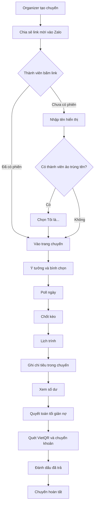
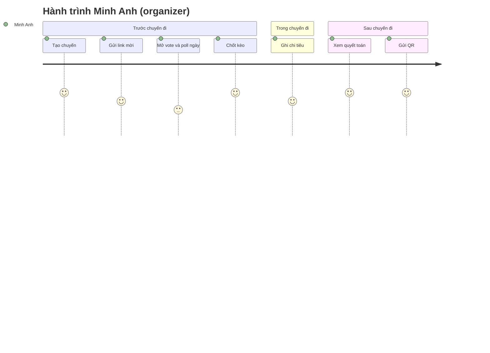

# Tripmate — Persona và User Journey

- **Mục đích:** Cụ thể hóa người dùng và hành trình của họ để mọi quyết định sản phẩm sau này có điểm tựa.
- **Phiên bản:** 0.1
- **Cập nhật lần cuối:** 18/11/2026

## Tóm tắt

Ba persona đại diện cho ba vai trò trong một nhóm đi chơi: người tổ chức (Minh Anh), thành viên thụ động (Đức) và người ngại nói chuyện tiền (Lan). Mỗi persona có hành trình ba giai đoạn (trước, trong, sau chuyến đi). Tài liệu cũng liệt kê "khoảnh khắc quyết định" mà app phải làm thật tốt, vì đó là nơi người dùng quyết định ở lại hay bỏ đi.

---

## 1. Persona

### P1 — Minh Anh, người tổ chức

| Mục | Nội dung |
|-----|----------|
| Tuổi, nghề, nơi ở | 27 tuổi, chuyên viên marketing, Hà Nội |
| Thói quen đi chơi | 3–4 chuyến/năm, nhóm 6–8 người, thường đi cuối tuần dài. Luôn là người "bị giao" việc tổ chức |
| Công cụ hiện tại | Group Zalo, Google Sheets, ghi chú điện thoại, tự ứng tiền đặt phòng |
| Nỗi đau | Phải đi gom ý kiến từng người; ứng tiền trước và lo quên ai nợ; cuối chuyến mất cả buổi tối tính toán; ngại nhắc người chưa trả |
| Kỳ vọng với app | Tạo chuyến nhanh dưới 1 phút; thấy ngay ai chưa vote; số dư rõ ràng; có cách nhắc nợ lịch sự mà không phải mở lời |
| Điều khiến cô bỏ app | Bạn bè không chịu vào; phải nhập quá nhiều; thấy mất dữ liệu |
| Liên kết | PP-01, PP-02, PP-03, PP-06 |

### P2 — Đức, thành viên thụ động

| Mục | Nội dung |
|-----|----------|
| Tuổi, nghề, nơi ở | 24 tuổi, kỹ sư phần mềm, Hà Nội |
| Thói quen đi chơi | Đi theo nhóm, ít khi tự đề xuất, hay trả lời "sao cũng được", đọc tin nhắn trễ |
| Công cụ hiện tại | Chỉ Zalo; không muốn cài thêm app |
| Nỗi đau | Bị hỏi ý kiến lúc đang bận; quên trả tiền vì không ai nhắc đúng lúc; không biết mình nợ bao nhiêu |
| Kỳ vọng với app | Bấm link là vào, không đăng ký; vote một chạm; mở lên thấy ngay "mình nợ ai bao nhiêu" |
| Điều khiến anh bỏ app | Phải tạo tài khoản; màn hình quá dày chữ; thông báo dồn dập |
| Liên kết | PP-02, PP-05, PP-08 |

### P3 — Lan, người ngại nói chuyện tiền

| Mục | Nội dung |
|-----|----------|
| Tuổi, nghề, nơi ở | 31 tuổi, giáo viên tiểu học, Hà Nội |
| Thói quen đi chơi | Đi cùng nhóm bạn đại học, thu nhập không cao, hay ăn ít hoặc không dự một số hoạt động |
| Công cụ hiện tại | Zalo; hay tự trả phần dư để tránh phiền người khác |
| Nỗi đau | Ngại nói "mình không ăn món đó nên đừng chia đều"; ngại đòi lại 85.000₫; sợ bị coi là chi li |
| Kỳ vọng với app | Có cách loại mình ra khỏi một khoản chi mà không phải giải thích với cả nhóm; nhắc nợ do app làm, không do người |
| Điều khiến cô bỏ app | Bị lộ khoản nợ của mình trước cả nhóm theo cách xấu hổ; ghi chú chỉ trích |
| Liên kết | PP-04, PP-05 |

---

## 2. User Journey

Ký hiệu cảm xúc: 😀 tích cực, 😐 trung tính, 😟 tiêu cực.

### 2.1 Journey P1 — Minh Anh

| Giai đoạn | Bước | Hành động | Cảm xúc | Điểm đau | Cơ hội |
|-----------|------|-----------|---------|----------|--------|
| **Trước chuyến đi** | 1 | Có ý rủ đi chơi, tạo chuyến "Đà Lạt 12/2026" | 😀 | Sợ phải cấu hình nhiều | Tạo chuyến chỉ cần tên; mọi thứ khác điền sau |
| | 2 | Gửi link mời vào group Zalo | 😐 | Không biết ai đã vào | Hiển thị "5/8 đã vào", nút sao chép link và QR |
| | 3 | Đề xuất 3 điểm đến, mở bình chọn | 😀 | Ý kiến bị trôi | Danh sách ý tưởng có số vote, dễ so sánh |
| | 4 | Mở poll ngày, chờ mọi người chọn | 😟 | Người im lặng | Thấy ai chưa trả lời, nhắc một chạm |
| | 5 | Chốt điểm đến và ngày | 😀 | Sợ chốt rồi lại đổi | Nút "Chốt kèo" có thể mở lại, kèm thông báo |
| | 6 | Dựng lịch trình theo ngày | 😐 | Mất thời gian | Tạo hoạt động từ ý tưởng đã chốt |
| **Trong chuyến đi** | 7 | Đặt homestay, ghi khoản chi đầu tiên | 😀 | Chia thế nào cho đúng | Mặc định chia đều cho tất cả, sửa được |
| | 8 | Ghi chi tiêu lặt vặt mỗi ngày | 😐 | Nhập tay mất công | Bottom sheet nhập nhanh, ghi nhớ lựa chọn gần nhất |
| **Sau chuyến đi** | 9 | Xem số dư và "ai trả ai" | 😀 | Tin vào con số không | Giải thích cách tính, hiển thị minh bạch |
| | 10 | Gửi QR thanh toán cho từng người | 😀 | Ngại nhắc | Màn hình quyết toán gửi được link cá nhân |
| | 11 | Đánh dấu đã nhận tiền | 😀 | Quên ai đã trả | Trạng thái từng khoản chuyển |

### 2.2 Journey P2 — Đức

| Giai đoạn | Bước | Hành động | Cảm xúc | Điểm đau | Cơ hội |
|-----------|------|-----------|---------|----------|--------|
| **Trước chuyến đi** | 1 | Bấm link trong Zalo | 😐 | Sợ bị bắt đăng ký | Vào thẳng, chỉ hỏi tên |
| | 2 | Nhập tên, thấy trang chuyến | 😀 | Không hiểu ngay | Màn hình đầu hiển thị việc cần mình làm |
| | 3 | Vote điểm đến, chọn ngày rảnh | 😀 | Lười | Vote một chạm, poll ngày dạng lưới đơn giản |
| **Trong chuyến đi** | 4 | Thỉnh thoảng xem lịch trình | 😐 | Cần xem lúc mạng yếu | Lịch trình xem được offline |
| | 5 | Thêm khoản chi khi mình trả hộ | 😐 | Quên | Nhập nhanh, mặc định người trả là mình |
| **Sau chuyến đi** | 6 | Mở app xem mình nợ ai | 😐 | Không biết nợ vì sao | Danh sách khoản chi liên quan đến mình |
| | 7 | Quét QR, chuyển khoản | 😀 | Nhập sai số tài khoản | QR có sẵn số tiền và nội dung |
| | 8 | Đánh dấu đã trả | 😀 | Quên bước này | Tự gợi ý đánh dấu sau khi quay lại app |

### 2.3 Journey P3 — Lan

| Giai đoạn | Bước | Hành động | Cảm xúc | Điểm đau | Cơ hội |
|-----------|------|-----------|---------|----------|--------|
| **Trước chuyến đi** | 1 | Vào bằng link, nhập tên | 😀 | — | — |
| | 2 | Đặt "ngày không thể đi" | 😟 | Ngại nói lý do | Poll ngày không bắt giải thích |
| **Trong chuyến đi** | 3 | Thấy khoản hải sản, mình không ăn | 😟 | Ngại nhắn riêng | Quyền sửa phần chia ngay trong app, hoặc yêu cầu loại trừ qua nút trung lập |
| | 4 | Người khác nhập chi tiêu có tên mình | 😐 | Sợ sai | Thông báo nhẹ "Khoản mới có bạn" để rà soát |
| **Sau chuyến đi** | 5 | Thấy mình còn nợ | 😟 | Sợ bị bêu xấu | Chỉ hiển thị số dư và giao dịch cần làm, không có "bảng xếp hạng người nợ" |
| | 6 | Nhận nhắc nhở từ app | 😀 | Bị coi là thúc giục | Nhắc nhở trung tính do hệ thống gửi, lời lẽ lịch sự |
| | 7 | Thấy khoản mình được nhận | 😀 | Ngại đòi | App hiển thị để người nợ tự thấy |

---

## 3. Sơ đồ luồng chính

---

## 4. Khoảnh khắc quyết định (Moments of Truth)

| ID | Khoảnh khắc | Vì sao quan trọng | Tiêu chí thành công |
|----|-------------|-------------------|--------------------|
| MT-01 | **Lần đầu được mời (bấm link)** | Mất người ngay nếu bị chặn bởi đăng ký hoặc chờ tải lâu | Từ lúc mở link đến thấy trang chuyến dưới 20 giây, tối đa 2 thao tác |
| MT-02 | **Organizer tạo chuyến đầu tiên** | Nếu mất hơn 1 phút, họ quay lại dùng Zalo | Tạo chuyến chỉ cần 1 trường bắt buộc (tên) |
| MT-03 | **Lần đầu ghi chi tiêu** | Quyết định app có đáng dùng suốt chuyến không | Tối đa 4 chạm: số tiền, người trả (mặc định mình), chia (mặc định đều), lưu |
| MT-04 | **Lần đầu xem số dư** | Nơi người dùng quyết định tin hay không tin app | Mỗi số dư có thể truy ngược về khoản chi; không có số lẻ khó hiểu |
| MT-05 | **Lần đầu mở QR thanh toán** | Khoảnh khắc "wow" của sản phẩm | QR hiển thị trong 1 giây, quét được ở ngân hàng phổ biến, có sẵn số tiền và nội dung |
| MT-06 | **Khi người dùng ẩn danh mất phiên** | Mất niềm tin và dữ liệu | Có cách khôi phục không cần hỗ trợ thủ công |
| MT-07 | **Khi sửa khoản chi đã quyết toán** | Dễ gây nợ sai và cãi nhau | Cảnh báo rõ, tính lại số dư minh bạch, lưu lịch sử sửa |

---

## Câu hỏi mở

1. Poll ngày nên là dạng "rảnh/có thể/bận" hay chỉ "rảnh/không rảnh"? Dạng đơn giản hơn dễ dùng hơn nhưng mất thông tin.
2. Thành viên có được phép tự loại mình khỏi một khoản chi (Lan) hay chỉ người nhập khoản đó mới sửa được?
3. Nhắc nợ: app gửi thông báo đẩy (push) hay chỉ hiển thị trong app? Push trên iOS PWA có hạn chế và cần người dùng cài về màn hình chính.
4. Người ẩn danh khôi phục phiên bằng cách nào ngoài Google (mã khôi phục, link cá nhân)?
5. Có cho organizer xem "ai chưa vote" theo tên không, hay sẽ làm người thụ động ngại?

## Quyết định cần chốt

| ID | Quyết định | Đề xuất |
|----|-----------|---------|
| D-05 | Poll ngày dạng ba trạng thái hay hai | Ba trạng thái (rảnh/có thể/bận), mặc định hiển thị đơn giản |
| D-06 | Cơ chế người dùng tự loại khỏi khoản chi | Cho phép thành viên "đề nghị chỉnh phần chia", người nhập hoặc organizer duyệt (xem FR-28) |
| D-07 | Phương án khôi phục danh tính ẩn danh | Link cá nhân + nâng cấp Google; chi tiết ở `06-architecture.md` |
