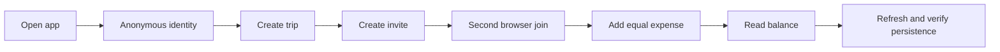

# Tripmate — User Stories và Backlog

**Mục đích:** Chuyển PRD thành backlog có thể triển khai theo từng lát cắt dọc, ưu tiên cho một solo developer và giữ liên kết với persona/yêu cầu.

**Phiên bản:** 0.1

**Cập nhật lần cuối:** 2026-11-17

**Tóm tắt:** Backlog được tổ chức theo Epic và chia thành 6 phase. Phase 1 tạo vertical slice nhỏ nhất: tạo trip → join bằng link → thêm một expense → xem số dư cơ bản. Các phase sau mở rộng poll, itinerary, split nâng cao, settlement/VietQR, hardening và pilot.

## 1. Quy ước

- Priority dùng MoSCoW: `Must`, `Should`, `Could`, `Won't`.
- Size: `S` ≤0.5 ngày, `M` 1–2 ngày, `L` 3–5 ngày của solo developer, gồm code + test cơ bản.
- Story chỉ được coi là Done khi có UI, server validation, RLS phù hợp, error/empty state và test theo mức của phase.
- ID story `US-*` liên kết tới `FR-*`, persona (`PER-*`) và màn hình (`SCR-*`).

## 2. Epic overview

| Epic | Mục tiêu | Story count | Ưu tiên | Size tổng tương đối |
|---|---|---:|---|---|
| EP-01 Trip & Join | Tạo trip, anonymous identity và mời member | 7 | Must | L |
| EP-02 Poll & Chốt kèo | Đồng quyết định destination/date | 6 | Must | L |
| EP-03 Itinerary | Lịch trình theo ngày, reorder, share summary | 6 | Must | L |
| EP-04 Expense & Budget | Ghi chi phí, nhiều kiểu chia, estimate | 10 | Must/Should | XL |
| EP-05 Settlement & VietQR | Net balance, transfer, trạng thái trả, QR | 8 | Must | XL |
| EP-06 Reliability & Privacy | RLS, realtime fallback, PWA, observability | 8 | Must | L |
| EP-07 Launch learning | Analytics tối giản, feedback, pilot | 5 | Should | M |

## 3. Backlog chi tiết

### EP-01 — Trip & Join

| ID | User story | Liên kết | Size | Priority |
|---|---|---|---|---|
| US-01 | Là Linh, tôi muốn tạo trip bằng tên và display name để có một không gian chung ngay lập tức. | FR-TRIP-01, PER-01, SCR-CREATE | S | Must |
| US-02 | Là người dùng mới, tôi muốn được tạo anonymous identity tự động để không phải đăng ký trước khi tạo/join. | FR-TRIP-02, FR-AUTH-01, PER-06 | M | Must |
| US-03 | Là Linh, tôi muốn copy invite link/QR để mời cả nhóm trong một thao tác. | FR-TRIP-03, FR-SHARE-01, PER-02 | M | Must |
| US-04 | Là Minh, tôi muốn xem trip preview trước khi join để biết link có đúng chuyến đi. | FR-TRIP-04, FR-SHARE-01, PER-06, SCR-JOIN | S | Must |
| US-05 | Là Minh, tôi muốn join bằng display name để tham gia mà không cung cấp email. | FR-TRIP-04, PER-07, SCR-JOIN | S | Must |
| US-06 | Là Linh, tôi muốn thêm virtual member để tính người chưa vào app. | FR-MEM-01, PER-02, SCR-MEMBERS | M | Must |
| US-07 | Là Linh, tôi muốn thấy ai đã join/pending và revoke link cũ để kiểm soát nhóm. | FR-MEM-02, FR-SHARE-02, PER-02 | M | Must |

### EP-02 — Poll & Chốt kèo

| ID | User story | Liên kết | Size | Priority |
|---|---|---|---|---|
| US-08 | Là Linh, tôi muốn tạo poll điểm đến với vài option để nhóm chọn thay vì nhắn rời rạc. | FR-POLL-01, PER-05, SCR-POLL | M | Must |
| US-09 | Là Linh, tôi muốn tạo poll ngày với single/multi-choice phù hợp để tìm ngày chung. | FR-POLL-01, FR-POLL-03, PER-05 | M | Must |
| US-10 | Là Minh, tôi muốn vote một chạm và đổi vote trước khi khóa để ý kiến của mình được ghi nhận. | FR-POLL-02, PER-07, SCR-POLL | S | Must |
| US-11 | Là Linh, tôi muốn xem kết quả và khóa poll để nhóm có một quyết định rõ ràng. | FR-POLL-04, PER-03, SCR-POLL-RESULT | M | Must |
| US-12 | Là member, tôi muốn biết poll đã khóa và ai khóa để không sửa nhầm. | FR-POLL-04, FR-POLL-06, MOM-04 | S | Must |
| US-13 | Là Linh, tôi muốn mở lại poll trong trường hợp chưa có dữ liệu phụ thuộc để xử lý thay đổi kế hoạch. | FR-POLL-05, BR-11 | M | Should |

### EP-03 — Itinerary

| ID | User story | Liên kết | Size | Priority |
|---|---|---|---|---|
| US-14 | Là Linh, tôi muốn tạo ngày và thêm item có địa điểm/thời gian để biến kết quả poll thành kế hoạch. | FR-ITIN-01, FR-ITIN-02, PER-04 | M | Must |
| US-15 | Là Minh, tôi muốn xem itinerary theo từng ngày và thấy hoạt động tiếp theo để không phải hỏi lại group chat. | FR-ITIN-06, PER-08, SCR-ITINERARY | S | Must |
| US-16 | Là Linh, tôi muốn kéo thả/reorder item để thay đổi thứ tự mà không nhập lại. | FR-ITIN-03, PER-04 | M | Must |
| US-17 | Là owner, tôi muốn thêm nhanh option poll vào itinerary để tránh copy dữ liệu. | FR-ITIN-04, DIF-01 | S | Should |
| US-18 | Là member, tôi muốn sửa item do mình tạo và thấy thời điểm cập nhật để tin vào phiên bản hiện tại. | FR-ITIN-05, FR-REAL-01 | M | Must |
| US-19 | Là Linh, tôi muốn share summary itinerary để kéo member quay lại trip. | FR-ITIN-06, FR-SHARE-01 | S | Should |

### EP-04 — Expense & Budget

| ID | User story | Liên kết | Size | Priority |
|---|---|---|---|---|
| US-20 | Là Huyền, tôi muốn thêm expense nhanh với payer mặc định là mình để ghi ngay lúc phát sinh. | FR-EXP-01, FR-EXP-06, PER-11, SCR-EXPENSE-SHEET | M | Must |
| US-21 | Là member, tôi muốn chọn ai tham gia expense để người không dùng dịch vụ không bị tính. | FR-EXP-02, PER-09 | M | Must |
| US-22 | Là member, tôi muốn chia đều và xem preview từng phần trước khi lưu. | FR-EXP-03, FR-EXP-05, MOM-06 | M | Must |
| US-23 | Là Huyền, tôi muốn chia theo số tiền exact để xử lý các hóa đơn không đều. | FR-EXP-03, PER-12 | M | Must |
| US-24 | Là member, tôi muốn chia theo percentage hoặc shares để phản ánh mức sử dụng khác nhau. | FR-EXP-03, BR-05, BR-07 | L | Must |
| US-25 | Là member, tôi muốn xem breakdown một expense để giải thích số tiền của mình. | FR-EXP-05, PER-12, SCR-EXPENSE-DETAIL | S | Must |
| US-26 | Là creator, tôi muốn xem tổng actual theo category so với estimate để kiểm soát ngân sách. | FR-BUDGET-01, FR-BUDGET-02, PER-01 | M | Should |
| US-27 | Là owner, tôi muốn sửa/void expense với warning nếu settlement bị ảnh hưởng. | FR-EXP-04, FR-EXP-07, BR-03 | M | Must |
| US-28 | Là member, tôi muốn draft expense không mất khi đóng bottom sheet ngoài ý muốn. | FR-EXP-06, NFR-OFF-01 | S | Should |
| US-29 | Là owner, tôi muốn giới hạn số expense/member để bảo vệ free tier và UX. | DEC-PRD-07, NFR-COST-01 | S | Should |

### EP-05 — Settlement & VietQR

| ID | User story | Liên kết | Size | Priority |
|---|---|---|---|---|
| US-30 | Là Huyền, tôi muốn biết mình sẽ nhận hay cần trả bao nhiêu sau khi trừ mọi khoản. | FR-SET-01, PER-13, SCR-SETTLEMENT | M | Must |
| US-31 | Là Linh, tôi muốn xem danh sách transfer ít nhất có thể để nhóm ít chuyển khoản hơn. | FR-SET-02, PER-05 | L | Must |
| US-32 | Là member, tôi muốn mở breakdown từ balance đến expense nguồn để kiểm tra công thức. | FR-SET-03, PER-12 | M | Must |
| US-33 | Là debtor, tôi muốn copy nội dung chuyển khoản hoặc mở VietQR của recipient để trả đúng người/đúng số tiền. | FR-SET-05, FR-SET-06, PER-10, SCR-VIETQR | L | Must |
| US-34 | Là debtor, tôi muốn đánh dấu đã chuyển mà không làm app giả vờ xác nhận ngân hàng. | FR-SET-04, PER-14 | S | Must |
| US-35 | Là recipient, tôi muốn xác nhận đã nhận tiền để nhóm biết transfer hoàn tất. | FR-SET-04, PER-15 | S | Must |
| US-36 | Là Linh, tôi muốn biết settlement cần tính lại nếu expense bị sửa sau snapshot. | FR-SET-07, BR-03 | M | Must |
| US-37 | Là owner, tôi muốn đóng trip khi các transfer đã hoàn tất và vẫn xem lịch sử sau đó. | FR-SET-08, MOM-12 | M | Should |

### EP-06 — Reliability & Privacy

| ID | User story | Liên kết | Size | Priority |
|---|---|---|---|---|
| US-38 | Là member, tôi muốn thay đổi của trip cập nhật realtime hoặc có refresh rõ để không dùng dữ liệu cũ. | FR-REAL-01, FR-REAL-02, NFR-REL-01 | M | Must |
| US-39 | Là user, tôi muốn chỉ member của trip đọc/ghi được dữ liệu để cảm thấy an toàn. | FR-PRIV-01, NFR-SEC-01 | L | Must |
| US-40 | Là Huyền, tôi muốn bank details được che và không xuất hiện trong analytics/log. | FR-SET-05, NFR-SEC-03, PER-13 | M | Must |
| US-41 | Là Minh, tôi muốn đọc itinerary cached khi mất mạng nhưng biết dữ liệu đã cũ. | NFR-OFF-01, NFR-COMP-02 | M | Should |
| US-42 | Là user dùng keyboard/screen reader, tôi muốn thao tác poll, expense và settlement đầy đủ. | NFR-A11Y-01, NFR-A11Y-02 | M | Must |
| US-43 | Là solo developer, tôi muốn thấy error có correlation id và quota để debug production. | NFR-OBS-01, NFR-COST-01 | M | Must |
| US-44 | Là owner, tôi muốn trip private không bị search engine index. | NFR-SEO-01, NFR-PRIV-01 | S | Must |

### EP-07 — Launch learning

| ID | User story | Liên kết | Size | Priority |
|---|---|---|---|---|
| US-45 | Là product owner, tôi muốn đo các event không chứa nội dung nhạy cảm để biết funnel join → settlement. | GOAL-02, GOAL-03, NFR-SEC-03 | M | Should |
| US-46 | Là người dùng pilot, tôi muốn gửi feedback từ trip mà không phải viết email dài. | GOAL-04, MOM-12 | S | Should |
| US-47 | Là product owner, tôi muốn biết lỗi nào xảy ra trên mobile/browser nào để ưu tiên sửa. | NFR-COMP-01, NFR-OBS-01 | S | Must |
| US-48 | Là product owner, tôi muốn export dữ liệu aggregate của pilot mà không lấy raw bank/expense note. | MON-01, NFR-PRIV-01 | M | Could |
| US-49 | Là owner, tôi muốn share một summary đẹp sau trip để mời nhóm dùng lại. | DIF-02, GOAL-01 | S | Could |

## 4. Phân chia phase/sprint cho solo developer

### Phase 0 — Foundation (tuần 1)

**Mục tiêu:** Project chạy được, schema/migration/test harness/RLS skeleton sẵn sàng.

**Stories:** nền cho `US-01`, `US-02`, `US-39`, `US-43`, `US-47`.

**Definition of Done:**

- React + Vite + TypeScript project, lint/typecheck/test/build command chạy được.
- Dockerfile và Docker Compose cho local/CI chạy được; Docker không phải production runtime bắt buộc.
- Supabase local/project dev có migration đầu tiên và seed tối thiểu.
- Auth anonymous, environment variables và error boundary hoạt động.
- RLS deny-by-default có test cross-trip fail.
- Có deploy preview và hướng dẫn setup trong README kỹ thuật.

### Phase 1 — Thinnest vertical slice (tuần 2–3)

**Mục tiêu:** Một người tạo trip, người thứ hai join, thêm một expense equal và xem balance.

**Stories:** `US-01`–`US-07`, `US-20`–`US-22`, `US-30` phiên bản đơn giản, `US-39`.

**Definition of Done:**

- Link invite hoạt động trên thiết bị khác.
- Two users nhìn thấy cùng trip và member list.
- Expense 100000₫ chia đều 2 người lưu đúng; refresh không nhân đôi.
- Balance hiện “Bạn cần trả/Bạn sẽ nhận” đúng.
- E2E Playwright chạy từ create → join → expense → balance.

### Phase 2 — Chốt kèo và itinerary (tuần 4–5)

**Mục tiêu:** Nhóm hoàn tất quyết định điểm đến/ngày và có kế hoạch theo ngày.

**Stories:** `US-08`–`US-19`.

**Definition of Done:**

- Poll single/multi-choice, vote, lock, permission và empty/error state.
- Chuyển option đã lock thành itinerary item không duplicate.
- Itinerary mobile có reorder keyboard alternative.
- Realtime hoặc refresh fallback được test trên hai browser.

### Phase 3 — Expense đầy đủ (tuần 6)

**Mục tiêu:** Ghi các hóa đơn thật với split method đủ dùng.

**Stories:** `US-23`–`US-29`.

**Definition of Done:**

- Equal/exact/percentage/shares có unit test và preview.
- Integer rounding deterministic; tổng phần luôn bằng amount.
- Edit/void và revision warning hoạt động.
- Budget estimate không làm sai settlement.

### Phase 4 — Settlement và VietQR (tuần 7)

**Mục tiêu:** Từ expense thật đến transfer tối giản, có payment instruction.

**Stories:** `US-31`–`US-37`, `US-40`.

**Definition of Done:**

- Settlement algorithm có tối thiểu 10 test case.
- Transfer trạng thái đủ, recipient confirm độc lập với debtor marked paid.
- QR payload/image và fallback copy được kiểm tra với dữ liệu mẫu.
- Expense revision sau settlement được xử lý an toàn.

### Phase 5 — PWA, accessibility, hardening (tuần 8)

**Mục tiêu:** MVP đủ tin cậy để test nhóm thật.

**Stories:** `US-38`, `US-41`–`US-44`, `US-47`.

**Definition of Done:**

- RLS/integration/security tests pass.
- Mobile QA trên iOS Safari và Android Chrome.
- PWA installable; cache không làm mất draft.
- Sentry/quota/event privacy checklist pass.
- Không còn P0/P1 blocker đã biết.

### Phase 6 — Closed pilot (tuần 9–10)

**Mục tiêu:** 10–20 nhóm thật dùng chuyến đi hoặc mô phỏng gần thật, thu feedback và chốt public MVP.

**Stories:** `US-45`, `US-46`, `US-48`, `US-49` nếu không ảnh hưởng core.

**Definition of Done:**

- Có cohort và consent/feedback flow.
- Tổng hợp funnel, lỗi, qualitative feedback.
- Backlog post-pilot được phân loại Must fix/Should fix/Later.
- Quyết định public launch được ghi trong release checklist.

## 5. Thinnest vertical slice

Slice này cố tình chưa cần poll, itinerary đầy đủ, VietQR hay realtime. Nó kiểm chứng ba rủi ro nền tảng sớm nhất: anonymous identity, RLS/membership và tiền VND integer. Sau khi slice chạy thật trên hai thiết bị, các module còn lại mới đáng đầu tư.

## 6. Câu hỏi mở

1. Solo developer có thể dành bao nhiêu giờ mỗi tuần; các phase trên giả định khoảng 20–25 giờ/tuần?
2. Có chấp nhận Phase 1 chỉ có equal split để rút ngắn time-to-first-value không?
3. Có cần budget estimate trong pilot hay chỉ ghi expense thật?
4. Có cần release public ở tuần 8 hay chờ đủ 10–20 nhóm pilot ở tuần 10?
5. “Must” của accessibility có bao gồm screen reader test thực tế hay chỉ automated axe + keyboard trong MVP?

## Quyết định cần chốt

| Mã | Quyết định | Đề xuất mặc định |
|---|---|---|
| DEC-BL-01 | Thứ tự build | Foundation → vertical slice → poll/itinerary → split nâng cao → settlement/QR → hardening. |
| DEC-BL-02 | MVP gate | Không bắt đầu pilot nếu vertical slice, RLS, rounding và settlement cơ bản chưa pass. |
| DEC-BL-03 | Equal split | Là Must và là split đầu tiên trong vertical slice; exact/percentage/shares làm ở Phase 3. |
| DEC-BL-04 | Pilot timing | Pilot kín ở tuần 9–10; chỉ public sau khi xử lý P0/P1 và rà lại quota. |
