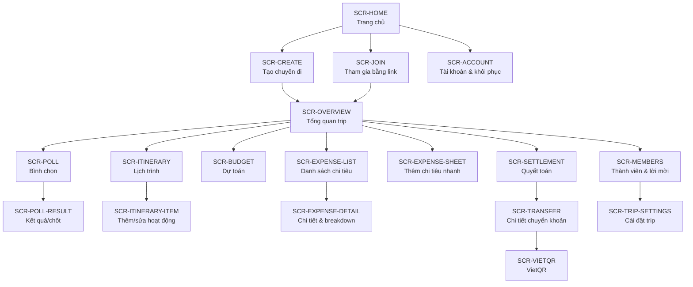

# Tripmate — UX và Screen Specification

**Mục đích:** Đặc tả nguyên tắc UX, điều hướng, màn hình, trạng thái và các pattern UI để PRD có thể chuyển thành thiết kế/implementation nhất quán.

**Phiên bản:** 0.1

**Cập nhật lần cuối:** 2026-11-17

**Tóm tắt:** Tripmate ưu tiên mobile-first, join trước đăng nhập, thao tác nhanh và nội dung có thể giải thích. Navigation chính nằm trong context của một trip; các hành động thường xuyên như thêm expense dùng bottom sheet, còn việc có hậu quả như khóa poll, void expense và xác nhận thanh toán dùng confirm rõ ràng.

## 1. Nguyên tắc thiết kế

| ID | Nguyên tắc | Quy tắc áp dụng |
|---|---|---|
| UX-PR-01 | Mobile-first | Thiết kế từ viewport 360px; CTA nằm trong vùng ngón tay; desktop chỉ mở rộng layout. |
| UX-PR-02 | Không bắt đăng nhập trước | Join/create dùng anonymous identity; prompt Google chỉ xuất hiện sau khi user đã tạo giá trị. |
| UX-PR-03 | Nhập liệu nhanh | Quick add, numeric keyboard, default payer/current member, preset category, progressive disclosure. |
| UX-PR-04 | Luôn giải thích aggregate | Balance/total/transfer đều drill-down được về expense nguồn. |
| UX-PR-05 | Trạng thái rõ hơn màu | Dùng label/icon/text cùng màu; ví dụ `Đang chờ`, `Đã đánh dấu đã trả`, `Đã xác nhận`. |
| UX-PR-06 | Không gây bất ngờ | Lock poll, void expense, revoke invite và close trip đều có hậu quả hiển thị trước khi xác nhận. |
| UX-PR-07 | Tôn trọng ngữ cảnh xã hội | Dùng “Bạn cần trả”, “Bạn sẽ nhận”, tránh “con nợ”; message share lịch sự, không gây áp lực. |
| UX-PR-08 | Offline có thể hiểu | Badge `Ngoại tuyến`/`Dữ liệu cập nhật lúc...`; không tuyên bố save nếu server chưa xác nhận. |
| UX-PR-09 | Private by default | Bank details không nằm trong overview/activity; QR hiển thị sau action chủ động. |

## 2. Sơ đồ điều hướng



## 3. Danh sách màn hình

| ID | Màn hình | Mục đích | Thành phần UI chính | Dữ liệu | Hành động chính |
|---|---|---|---|---|---|
| SCR-HOME | Trang chủ | Tạo/mở trip gần đây | Logo, CTA tạo, input join code, danh sách trip | Trip user có quyền xem, pending invites | Tạo, join, mở trip, account |
| SCR-CREATE | Tạo chuyến đi | Tạo trip tối thiểu | Name, destination, date range, display name | Form draft | Tạo trip, hủy |
| SCR-JOIN | Tham gia bằng link | Xác nhận context và join | Trip preview, creator, display name, privacy note | Public trip metadata, invite status | Join, đổi tên, thoát |
| SCR-OVERVIEW | Tổng quan trip | Next action và trạng thái chung | Header, progress, next event, balance card, tabs, quick add | Trip, members, poll summary, itinerary next, user balance | Share, quick add, mở module |
| SCR-INVITE | Mời thành viên | Tạo/chia sẻ invite | Link, QR, expiry, copy/share, revoke | Invite metadata | Copy, share, revoke |
| SCR-MEMBERS | Thành viên | Quản lý joined/virtual | Member list, role badge, pending, add virtual | Members, membership status | Add virtual, role, deactivate |
| SCR-POLL | Tạo/sửa poll | Thu thập lựa chọn | Title, type, options, deadline tùy chọn | Poll draft/options | Save, add option, cancel |
| SCR-POLL-RESULT | Kết quả poll | Xem vote và lock | Option bars, voters tùy privacy, lock CTA | Votes, status, winner | Vote, lock, reopen nếu được |
| SCR-ITINERARY | Lịch trình | Xem/sắp xếp theo ngày | Day tabs, item cards, today marker, add CTA | Itinerary days/items | Add, edit, reorder, share |
| SCR-ITINERARY-ITEM | Item form | Tạo/sửa hoạt động | Title, time, location, note, category | Item draft, source poll | Save, delete/void |
| SCR-BUDGET | Dự toán | So sánh estimate/actual | Category rows, total, progress | Budget estimates, expense aggregates | Add/edit estimate |
| SCR-EXPENSE-LIST | Chi tiêu | Xem expense feed | Filter category/payer/date, cards | Expense list, sync state | Add, open detail, filter |
| SCR-EXPENSE-SHEET | Bottom sheet thêm chi tiêu | Ghi expense nhanh | Amount, title, payer, participants, split selector, preview | Draft, members | Save, expand advanced, discard |
| SCR-EXPENSE-DETAIL | Chi tiết expense | Giải thích một khoản | Payer, amount, participants, breakdown, history | Expense, shares, revision | Edit/void nếu có quyền |
| SCR-SETTLEMENT | Quyết toán | Xem net và transfer | “Bạn sẽ nhận/trả”, transfer list, totals, stale warning | Balances, settlement snapshot | Open transfer, recalculate, close |
| SCR-TRANSFER | Chi tiết transfer | Hoàn tất một nghĩa vụ | From/to, amount, breakdown, payment instructions, status timeline | Transfer, recipient bank summary | Copy, show QR, marked paid/confirm |
| SCR-VIETQR | QR thanh toán | Hiển thị QR an toàn | QR image, bank name masked, amount, addInfo, warning | Ephemeral QR payload | Show/hide, download/share, copy |
| SCR-TRIP-SETTINGS | Cài đặt trip | Quyền, archive, delete request | Role, limits, privacy, danger zone | Trip config, audit summary | Revoke, archive, request delete |
| SCR-ACCOUNT | Tài khoản | Nâng cấp/khôi phục identity | Anonymous status, Google CTA, data export/delete | Auth identity, sessions | Link account, sign out |
| SCR-RECOVERY | Khôi phục | Giải thích session mất | Recovery instructions, invite/help | Session state | Sign in, contact owner |
| SCR-FEEDBACK | Feedback | Thu feedback ngắn | Rating, category, text, consent | Anonymous event context | Submit, dismiss |

## 4. Trạng thái bắt buộc của màn hình

Mọi màn hình có data phải có các trạng thái sau; các trạng thái riêng được nêu trong bảng màn hình không được bỏ qua.

| Trạng thái | Hành vi/hiển thị |
|---|---|
| Loading | Skeleton giữ bố cục; không hiển thị số 0 gây nhầm là dữ liệu rỗng. |
| Empty | Nói rõ vì sao rỗng và CTA kế tiếp, ví dụ “Chưa có khoản chi — Thêm khoản đầu tiên”. |
| Error | Message tiếng Việt có nguyên nhân vừa đủ, retry và mã hỗ trợ nếu cần; không lộ stack trace. |
| Offline/stale | Banner nhỏ, last synced time; mutation disabled hoặc chuyển thành draft rõ ràng. |
| Success | Toast/inline confirmation sau server ack; focus chuyển tới nội dung vừa tạo khi phù hợp. |
| Permission denied | Giải thích quyền không đủ và link quay về trip; không lộ dữ liệu mà user không được xem. |

## 5. Wireframe các màn hình chính

### 5.1 Trang chủ — `SCR-HOME`

```text
+----------------------------------+
| Tripmate                    [☺] |
|                                  |
| [ + Tạo chuyến đi ]              |
|                                  |
| Tham gia bằng mã                 |
| [ Nhập mã        ] [Tham gia]    |
|                                  |
| Chuyến đi của bạn                |
| ┌──────────────────────────────┐ |
| | Đà Lạt cuối tháng             | |
| | 6 người · 12–14/12            | |
| | Còn 2 việc cần làm      [>]   | |
| └──────────────────────────────┘ |
|                                  |
| [Chuyến đi] [Mời] [Tài khoản]    |
+----------------------------------+
```

### 5.2 Chi tiết chuyến — `SCR-OVERVIEW`

```text
+----------------------------------+
| [←] Đà Lạt cuối tháng    [...]  |
| 12–14/12 · Đà Lạt                |
| [Chia sẻ lời mời]                |
|                                  |
| Việc tiếp theo                   |
| ● Chốt ngày đi             [Mở] |
|                                  |
| Tóm tắt                          |
| [Đã chốt] [Lịch trình] [Chi tiền]|
|                                  |
| Hôm nay / Sự kiện tiếp theo      |
| 08:00 Tập trung · Bến xe         |
|                                  |
| Số dư của bạn                    |
| Bạn cần trả 250.000₫       [Xem]|
|                                  |
| [ + Thêm chi tiêu ]              |
| [Tổng quan][Lịch][Chi][Quyết toán]|
+----------------------------------+
```

### 5.3 Bình chọn — `SCR-POLL`

```text
+----------------------------------+
| [←] Chọn ngày đi                 |
| Chọn một ngày phù hợp             |
| Trạng thái: Đang mở              |
|                                  |
| ( ) 06–08/12       4 phiếu       |
| ( ) 13–15/12       5 phiếu       |
| ( ) 20–22/12       2 phiếu       |
|                                  |
| Bạn đã chọn: 13–15/12            |
| [Đổi lựa chọn]                   |
|                                  |
| [Lưu lựa chọn]                   |
|                                  |
| Owner: [Chốt kết quả]            |
+----------------------------------+
```

### 5.4 Lịch trình — `SCR-ITINERARY`

```text
+----------------------------------+
| [←] Lịch trình              [+]  |
| [Ngày 1] [Ngày 2] [Ngày 3]       |
|                                  |
| Thứ bảy · 13/12                  |
| ┌──────────────────────────────┐ |
| | 08:00  Tập trung              | |
| | Bến xe Miền Đông · Linh      | |
| └──────────────────────────────┘ |
|              ⋮                  |
| ┌──────────────────────────────┐ |
| | 12:00  Ăn trưa                | |
| | [Kéo] [Sửa]                  | |
| └──────────────────────────────┘ |
|                                  |
| [ + Thêm hoạt động ]             |
| [Tổng quan][Lịch][Chi][Quyết toán]|
+----------------------------------+
```

### 5.5 Thêm chi tiêu — `SCR-EXPENSE-SHEET`

```text
+----------------------------------+
| Kéo xuống để đóng                |
| Thêm khoản chi                   |
| [ 1.200.000             ₫ ]      |
|                                  |
| Khoản chi                        |
| [Tiền phòng                  ]   |
| Người trả                        |
| [Huyền                       v]   |
| Ai tham gia?                    |
| [✓ Linh] [✓ Minh] [✓ Huyền]     |
| Cách chia                        |
| [Đều v]                          |
|                                  |
| Mỗi người: 400.000₫              |
| [Xem chi tiết]                   |
|                                  |
| [Lưu khoản chi]                  |
+----------------------------------+
```

### 5.6 Quyết toán — `SCR-SETTLEMENT`

```text
+----------------------------------+
| [←] Quyết toán                   |
| Cập nhật: 13/12, 22:04           |
|                                  |
| Tóm tắt của bạn                  |
| Bạn sẽ nhận 500.000₫             |
|                                  |
| Các khoản cần chuyển             |
| ┌──────────────────────────────┐ |
| | Minh → Huyền                  | |
| | 250.000₫           [Chi tiết] | |
| | Đang chờ                       | |
| └──────────────────────────────┘ |
| ┌──────────────────────────────┐ |
| | Linh → Huyền                  | |
| | 250.000₫           [Chi tiết] | |
| └──────────────────────────────┘ |
|                                  |
| [Xem cách tính] [Tính lại]       |
+----------------------------------+
```

## 6. Luồng đặc biệt

### 6.1 Join bằng link

1. User mở URL `/join/{code}`.
2. Server kiểm tra invite status, trả public preview tối thiểu.
3. User nhập display name; nếu anonymous session chưa có thì tạo session.
4. Server redeem token atomically; duplicate identity trả về trip hiện tại thay vì tạo member mới.
5. Client chuyển tới Overview, hiển thị toast “Bạn đã tham gia chuyến đi”.
6. Nếu revoked/expired/full: không hiển thị member list; đưa nút liên hệ/copy owner message.

### 6.2 Thêm chi tiêu nhanh

1. Bấm FAB hoặc “+ Thêm chi tiêu” từ Overview.
2. Bottom sheet mở với amount autofocus và numeric keyboard.
3. Payer mặc định current user; participants mặc định active members theo business rule.
4. Chọn split method; preview từng share cập nhật local.
5. Validate integer, total và participants; save server.
6. Server ack → đóng sheet, cập nhật feed/balance; lỗi → giữ draft và focus field lỗi.

### 6.3 Chọn kiểu chia

| Kiểu | UI | Validation |
|---|---|---|
| Đều (`equal`) | Chọn participants; hiển thị mỗi người | Amount >0; remainder deterministic. |
| Theo số tiền (`exact`) | Một input cho từng participant | Tổng exact = amount. |
| Theo phần trăm (`percentage`) | Input % từng participant | Tổng =100%; amount share integer. |
| Theo phần (`shares`) | Input số phần, preview ratio | Shares >0; tổng phần không rỗng. |

### 6.4 Hiển thị VietQR

1. Trong Transfer, user bấm “Hiện VietQR”.
2. App kiểm tra recipient có bankBin/accountNumber/accountName; thiếu thì hướng dẫn bổ sung.
3. App render payload từ server/validated client model; che account number trong phần text.
4. Hiển thị QR, amount, recipient, addInfo và cảnh báo “Tripmate không xác nhận giao dịch ngân hàng”.
5. User copy/share; khi quay lại Transfer, trạng thái vẫn `pending`.

## 7. Design tokens gợi ý

### Màu sắc

| Token | Giá trị gợi ý | Dùng cho |
|---|---|---|
| `color-primary` | `#2563EB` | CTA, link, active tab |
| `color-primary-foreground` | `#FFFFFF` | Text trên primary |
| `color-success` | `#15803D` | Confirmed/success, không dùng một mình |
| `color-warning` | `#B45309` | Stale, pending, warning |
| `color-danger` | `#B91C1C` | Void, revoke, error |
| `color-surface` | `#FFFFFF` | Card/sheet |
| `color-muted` | `#64748B` | Secondary text |
| `color-border` | `#E2E8F0` | Divider/input border |

### Typography và spacing

| Token | Giá trị |
|---|---|
| Font | Inter hoặc system sans; hỗ trợ rõ dấu tiếng Việt. |
| Body | 16px / line-height 24px trên mobile. |
| Caption | 13–14px; không dùng dưới 12px cho thông tin quan trọng. |
| Heading | 20–28px, weight 600–700. |
| Spacing | Scale 4px: 4/8/12/16/24/32. |
| Radius | `8px` input/button, `12px` card, `16px` bottom sheet. |
| Touch target | Tối thiểu 44×44px. |
| Motion | 150–200ms; respect `prefers-reduced-motion`. |

### Component shadcn/ui gợi ý

`Button`, `Input`, `Textarea`, `Label`, `Card`, `Badge`, `Tabs`, `Dialog`, `Drawer`, `Sheet`, `AlertDialog`, `Select`, `Popover`, `Calendar`, `Checkbox`, `RadioGroup`, `Switch`, `Progress`, `Skeleton`, `Toast/Sonner`, `Tooltip`, `DropdownMenu`, `Command`, `ScrollArea`, `Separator`, `Avatar`, `Accordion`.

## 8. Nội dung giao diện tiếng Việt

| Context | Label/message đề xuất |
|---|---|
| Create | “Tạo chuyến đi”, “Tên chuyến đi”, “Điểm đến (có thể bỏ qua)”, “Ngày đi (có thể thêm sau)” |
| Join | “Bạn được mời tham gia”, “Tên hiển thị của bạn”, “Tham gia chuyến đi” |
| Invite | “Mời bạn đi cùng”, “Sao chép link mời”, “Link này đã được thu hồi” |
| Poll | “Đang mở”, “Bạn đã bình chọn”, “Chốt kết quả”, “Kết quả đã được chốt” |
| Itinerary | “Lịch trình”, “Hôm nay”, “Thêm hoạt động”, “Chưa có hoạt động nào cho ngày này” |
| Expense | “Thêm khoản chi”, “Ai đã trả?”, “Ai tham gia khoản này?”, “Cách chia”, “Xem cách chia” |
| Settlement | “Bạn cần trả”, “Bạn sẽ nhận”, “Các khoản cần chuyển”, “Đã đánh dấu đã trả”, “Đã xác nhận đã nhận” |
| QR | “Hiện VietQR”, “Sao chép nội dung”, “QR chỉ tạo hướng dẫn chuyển khoản; không xác nhận giao dịch” |
| Error | “Có lỗi khi lưu. Dữ liệu bạn nhập vẫn được giữ lại.”, “Bạn không có quyền thực hiện thao tác này.” |
| Offline | “Bạn đang ngoại tuyến”, “Dữ liệu có thể chưa mới nhất”, “Bản nháp sẽ được giữ trên thiết bị” |
| Empty | “Chưa có khoản chi”, “Thêm khoản đầu tiên để bắt đầu tính quyết toán” |
| Tone | Thân thiện, trung tính, cụ thể; tránh đổ lỗi và tránh ngôn ngữ ngân hàng quá kỹ thuật. |

## 9. Câu hỏi mở

1. Bottom navigation có giữ cố định 4 tab Overview/Lịch/Chi/Quyết toán hay cho phép owner/member có tab khác nhau?
2. Có cần hỗ trợ Zalo share trực tiếp hay MVP chỉ copy link/Web Share API?
3. Trip preview trước join được hiển thị destination/date nào nếu owner chưa chốt hoặc chưa nhập?
4. Có cho phép owner customize màu/ảnh trip không, hay giữ giao diện tối giản trong MVP?
5. Khi user vuốt đóng expense sheet với dữ liệu chưa lưu, dùng confirm dialog hay tự lưu draft luôn?
6. Có cần bản desktop/tablet riêng cho người tổ chức không, hay responsive layout là đủ?
7. QR có cho download image hay chỉ hiển thị/copy để giảm rủi ro lưu bank data trên máy?

## Quyết định cần chốt

| Mã | Quyết định | Đề xuất mặc định |
|---|---|---|
| DEC-UX-09 | Navigation | Bottom tabs trong trip: Tổng quan, Lịch, Chi tiêu, Quyết toán; Members/Settings ở menu phụ. |
| DEC-UX-10 | Share | Dùng Web Share API nếu có, fallback copy link; chưa tích hợp API riêng của Zalo/Messenger. |
| DEC-UX-11 | Expense close | Nếu có draft, confirm “Giữ bản nháp” hoặc “Xóa bản nháp”; không mất âm thầm. |
| DEC-UX-12 | QR output | Hiển thị + copy payload; cho phép share ảnh QR ở bản MVP nếu không log dữ liệu nhạy cảm. |
| DEC-UX-13 | Desktop | Dùng responsive layout; không làm dashboard desktop riêng cho MVP. |
