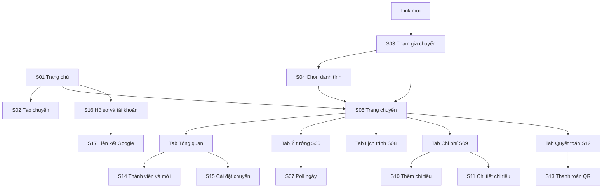
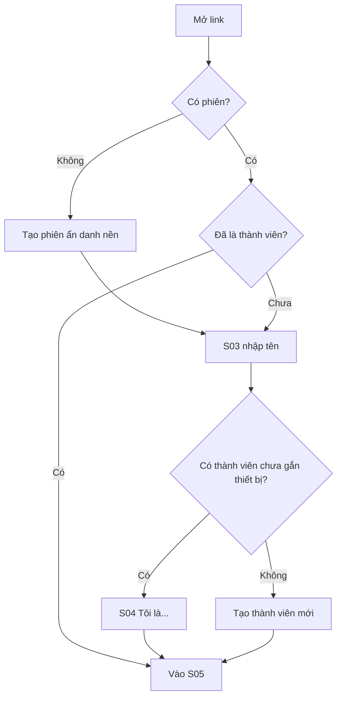

# Tripmate — Thiết kế UX và Màn hình

- **Mục đích:** Định nghĩa nguyên tắc thiết kế, sơ đồ điều hướng, danh sách màn hình, wireframe, luồng đặc biệt, design tokens và nội dung giao diện tiếng Việt.
- **Phiên bản:** 0.1
- **Cập nhật lần cuối:** 18/11/2026

## Tóm tắt

Tripmate được thiết kế mobile-first, vào là dùng (không đăng nhập trước), nhập liệu nhanh bằng bottom sheet và các giá trị mặc định thông minh. Có 17 màn hình (S01–S17). Điều hướng chính của một chuyến là 5 tab: Tổng quan, Ý tưởng, Lịch trình, Chi phí, Quyết toán. Phong cách: tối giản, nhiều khoảng trắng, một màu nhấn, tiền luôn rõ ràng và dễ đọc.

---

## 1. Nguyên tắc thiết kế

| ID | Nguyên tắc | Hệ quả cụ thể |
|----|-----------|---------------|
| UX-01 | **Mobile-first, một tay** | Hành động chính nằm vùng ngón cái (nửa dưới màn hình); nút chạm tối thiểu 44×44 px |
| UX-02 | **Không bắt đăng nhập trước** | Mọi thứ hoạt động với phiên ẩn danh; "Liên kết Google" chỉ gợi ý sau khi người dùng đã có giá trị (sau khoản chi đầu tiên) |
| UX-03 | **Nhập liệu nhanh** | Mặc định thông minh: người trả = mình, chia = đều cho tất cả; số tiền bàn phím số; ghi nhớ lựa chọn gần nhất |
| UX-04 | **Tiền phải minh bạch** | Mọi số dư truy ngược về khoản chi; hiển thị phép tính khi chia lẻ |
| UX-05 | **Một việc chính mỗi màn hình** | Mỗi màn có một CTA chính nổi bật |
| UX-06 | **Trạng thái rõ ràng** | Mọi màn hình có đủ trạng thái loading, rỗng, lỗi, thành công |
| UX-07 | **Không làm người dùng xấu hổ** | Không bảng xếp hạng người nợ; nhắc nhở trung tính |
| UX-08 | **Chạy tốt khi mạng yếu** | Cập nhật lạc quan, skeleton, dữ liệu đã tải xem được offline |

---

## 2. Sơ đồ điều hướng (Sitemap)



---

## 3. Danh sách màn hình

Trạng thái: **L** loading, **E** rỗng (empty), **R** lỗi (error), **S** thành công.

| ID | Màn hình | Mục đích | Thành phần UI chính | Dữ liệu hiển thị | Hành động | Trạng thái |
|----|----------|----------|---------------------|------------------|-----------|------------|
| S01 | Trang chủ | Xem và vào các chuyến của mình | Danh sách thẻ chuyến, nút Tạo chuyến | Tên, ngày, số thành viên, số dư của mình | Mở chuyến, tạo chuyến | L: skeleton thẻ. E: "Chưa có chuyến nào, tạo chuyến đầu tiên". R: thử lại |
| S02 | Tạo chuyến | Tạo chuyến nhanh | Ô tên (bắt buộc), điểm đến, ngày, emoji | — | Tạo | L: nút xoay. R: lỗi dưới ô. S: chuyển vào S05 |
| S03 | Tham gia chuyến | Bước đầu tiên của người được mời | Tên chuyến, người mời, số thành viên, ô tên hiển thị | Tên chuyến, tên owner | Vào nhóm | L: skeleton. R: "Link hết hiệu lực". S: vào S05 |
| S04 | Chọn danh tính | Nhận lại thành viên ảo hoặc khôi phục | Danh sách "Tôi là…", nút "Tôi là người mới" | Thành viên chưa gắn thiết bị | Chọn | E: bỏ qua màn này. R: "đã được nhận" |
| S05 | Trang chuyến (Tổng quan) | Trung tâm của chuyến | Header, 5 tab, thẻ "Việc cần làm", tóm tắt | Chốt kèo, lịch gần nhất, số dư của mình | Chuyển tab, Mời | L: skeleton. R: lỗi mạng. E: gợi ý bước tiếp theo |
| S06 | Ý tưởng và bình chọn | Đề xuất và vote | Bộ lọc loại, thẻ ý tưởng, nút vote, FAB thêm | Tên, số vote, ai vote, trạng thái chốt | Vote, thêm, chốt kèo | L: skeleton. E: "Chưa có ý tưởng. Thêm điểm đến đầu tiên" |
| S07 | Poll ngày | Chốt ngày đi | Lưới ngày × người, nút rảnh/có thể/bận, tổng hợp | Phương án ngày, câu trả lời | Trả lời, thêm phương án, chốt | E: "Thêm phương án ngày" |
| S08 | Lịch trình | Xem và sửa theo ngày | Tab ngày, danh sách hoạt động, tay cầm kéo thả | Giờ, tên, địa điểm, ghi chú | Thêm, sửa, sắp xếp | E: "Ngày này chưa có gì" |
| S09 | Chi phí | Theo dõi chi tiêu và dự toán | Tổng đã chi, thanh dự toán theo hạng mục, danh sách khoản chi | Khoản chi, người trả, số tiền | Thêm chi tiêu, lọc | E: "Chưa có khoản chi" |
| S10 | Thêm chi tiêu (bottom sheet) | Nhập chi tiêu nhanh | Số tiền, tên, người trả, người tham gia, kiểu chia, hạng mục, ngày | Tổng kiểm tra phần chia | Lưu | R: tổng chia sai, hiển thị còn thiếu/thừa |
| S11 | Chi tiết chi tiêu | Xem và sửa một khoản | Thông tin, bảng chia, lịch sử sửa | Ai trả, mỗi người chịu bao nhiêu | Sửa, xóa, đề nghị chỉnh | R: xung đột phiên bản |
| S12 | Quyết toán | Xem số dư và cách thanh toán | Số dư từng người, danh sách giao dịch đề xuất, trạng thái | Số dư, giao dịch | Thanh toán, đánh dấu, chốt | E: "Chưa có gì để quyết toán" |
| S13 | Thanh toán QR | Chuyển khoản dễ | QR lớn, số tiền, tên người nhận, số tài khoản, nút sao chép | Thông tin nhận tiền | Sao chép, đã chuyển | E: "Người nhận chưa có thông tin" và nút nhắc |
| S14 | Thành viên và mời | Mời và quản lý | Link, QR, danh sách thành viên, thêm thành viên ảo | Tên, trạng thái | Sao chép link, đổi mã, thêm/xóa | — |
| S15 | Cài đặt chuyến | Cấu hình | Tên, ngày, lưu trữ, xóa | — | Sửa, lưu trữ, xóa | — |
| S16 | Hồ sơ và tài khoản | Tên hiển thị, thông tin nhận tiền | Tên, ngân hàng, số tài khoản | Thông tin của mình | Lưu, xóa dữ liệu | — |
| S17 | Liên kết Google | Giữ dữ liệu khi đổi máy | Giải thích lợi ích, nút Liên kết | — | Liên kết | R: lỗi đăng nhập |

---

## 4. Wireframe

Ký hiệu: `[ ]` nút, `( )` lựa chọn, `▓` thanh tiến độ.

### 4.1 Trang chủ (S01)

```
┌──────────────────────────────┐
│ Tripmate               [👤]  │
├──────────────────────────────┤
│ Chuyến của bạn               │
│ ┌──────────────────────────┐ │
│ │ 🏔 Đà Lạt 12/2026        │ │
│ │ 6 người · 12–14/12       │ │
│ │ Bạn được nhận 200.000₫   │ │
│ └──────────────────────────┘ │
│ ┌──────────────────────────┐ │
│ │ 🌊 Vũng Tàu tháng 10     │ │
│ │ Đã quyết toán ✓          │ │
│ └──────────────────────────┘ │
│                              │
│              [ + Tạo chuyến ]│
└──────────────────────────────┘
```

### 4.2 Chi tiết chuyến với tab (S05)

```
┌──────────────────────────────┐
│ ←  Đà Lạt 12/2026   [Mời]    │
├──────────────────────────────┤
│ Việc cần làm                 │
│ • Chọn ngày rảnh  (2 ngày nữa)│
│ • Vote điểm đến   [Vote]     │
│                              │
│ Đã chốt: Đà Lạt ✓            │
│ Ngày: 12–14/12 ✓             │
│ Đã chi: 8.450.000₫           │
│ Bạn: +200.000₫               │
├──────────────────────────────┤
│ Tổng quan|Ý tưởng|Lịch|Chi|QT│
└──────────────────────────────┘
```

### 4.3 Bình chọn (S06)

```
┌──────────────────────────────┐
│ Ý tưởng      (Tất cả)(Điểm đến)│
├──────────────────────────────┤
│ ┌──────────────────────────┐ │
│ │ Đà Lạt            ✓ Chốt │ │
│ │ 5 vote · bạn đã vote 👍   │ │
│ └──────────────────────────┘ │
│ ┌──────────────────────────┐ │
│ │ Vũng Tàu                 │ │
│ │ 2 vote           [👍 Vote]│ │
│ └──────────────────────────┘ │
│  [Poll ngày]       [+ Thêm]  │
└──────────────────────────────┘
```

### 4.4 Lịch trình (S08)

```
┌──────────────────────────────┐
│ (Ngày 1)(Ngày 2)(Ngày 3)     │
├──────────────────────────────┤
│ ⋮⋮ 08:00 Ăn sáng bánh căn    │
│ ⋮⋮ 10:00 Đồi chè Cầu Đất     │
│       📍Mở bản đồ            │
│ ⋮⋮ 14:00 Nhận phòng homestay │
│                              │
│               [ + Hoạt động ]│
└──────────────────────────────┘
```

### 4.5 Thêm chi tiêu — bottom sheet (S10)

```
┌──────────────────────────────┐
│ ─── Thêm chi tiêu            │
│ Số tiền                      │
│ [        450.000 ₫        ]  │
│ Tên khoản  [ Ăn tối nhà hàng]│
│ Ai trả?    (Minh Anh ▾)      │
│ Chia cho   [✓Tất cả 6 người ▾]│
│ Kiểu chia  (Đều)(Số tiền)(%)(Phần)│
│ → Mỗi người 75.000₫          │
│ Hạng mục (Ăn uống ▾)  Hôm nay│
│ [           Lưu            ] │
└──────────────────────────────┘
```

### 4.6 Quyết toán (S12)

```
┌──────────────────────────────┐
│ Quyết toán                   │
│ Số dư                        │
│ Minh Anh  +1.250.000₫        │
│ Đức       −625.000₫          │
│ Lan       −625.000₫          │
├──────────────────────────────┤
│ Cần chuyển (2 giao dịch)     │
│ Đức → Minh Anh 625.000₫      │
│              [ Thanh toán ]  │
│ Lan → Minh Anh 625.000₫      │
│              [ Thanh toán ]  │
│ Giải thích cách tính ›       │
│        [ Chốt quyết toán ]   │
└──────────────────────────────┘
```

---

## 5. Luồng đặc biệt

### 5.1 Tham gia bằng link



Yêu cầu: tối đa 2 thao tác (nhập tên, bấm Vào nhóm). Link không hợp lệ hiển thị thông báo rõ ràng, không lộ thông tin chuyến.

### 5.2 Thêm chi tiêu nhanh

Từ tab Chi phí, FAB `+` mở bottom sheet S10 với con trỏ ở ô số tiền. Mặc định: người trả là mình, chia đều cho tất cả thành viên còn hoạt động. 4 chạm: số tiền, (tên tùy chọn), Lưu. Tên khoản bỏ trống thì dùng tên hạng mục. Lưu theo kiểu lạc quan; xung đột được báo khi đồng bộ.

### 5.3 Chọn kiểu chia

Bốn nút phân đoạn: **Đều**, **Số tiền**, **%**, **Phần**. Với mỗi kiểu, mỗi dòng thành viên có ô nhập (trừ Đều, chỉ có ô chọn tham gia). Phía dưới có thanh tổng kiểm tra: "Còn thiếu 20.000₫" hoặc "Khớp ✓". Nút Lưu bị khóa cho đến khi khớp.

### 5.4 Hiển thị QR thanh toán (S13)

Mở từ nút Thanh toán. QR lớn nằm giữa, bên dưới là số tiền, ngân hàng, số tài khoản (nút sao chép), nội dung chuyển khoản. Tăng độ sáng màn hình nếu có thể. Có nút "Đã chuyển" để đánh dấu. Nếu người nhận chưa nhập thông tin ngân hàng: hiển thị thông báo và nút "Nhắc [tên] nhập thông tin".

---

## 6. Design tokens

### 6.1 Màu sắc

| Token | Giá trị | Dùng cho |
|-------|---------|----------|
| `--brand` | `#0F766E` (teal 700) | CTA chính, liên kết |
| `--brand-soft` | `#CCFBF1` | Nền nhấn nhẹ |
| `--bg` | `#FAFAF9` | Nền trang |
| `--surface` | `#FFFFFF` | Thẻ |
| `--text` | `#1C1917` | Chữ chính |
| `--muted` | `#57534E` | Chữ phụ (đạt tương phản 4.5:1 trên nền trắng) |
| `--border` | `#E7E5E4` | Viền |
| `--positive` | `#15803D` | Được nhận tiền |
| `--negative` | `#B91C1C` | Phải trả |
| `--warning` | `#B45309` | Cảnh báo |

Màu không là tín hiệu duy nhất: số dư luôn kèm dấu `+`/`−` và chữ.

### 6.2 Typography

| Token | Giá trị |
|-------|---------|
| Font | Be Vietnam Pro hoặc Inter (hỗ trợ tiếng Việt đầy đủ); fallback hệ thống |
| Cỡ chữ | 12 / 14 / 16 (thân) / 20 / 24 / 32 (số tiền lớn) |
| Số tiền | Dùng chữ số tabular (`tabular-nums`), căn phải |
| Độ cao dòng | 1.5 cho nội dung, 1.2 cho tiêu đề |

### 6.3 Khoảng cách, bo góc, trạng thái

| Token | Giá trị |
|-------|---------|
| Khoảng cách | Thang 4 px: 4, 8, 12, 16, 24, 32 |
| Bo góc | 8 px (nút, ô nhập), 12 px (thẻ), 16 px (bottom sheet) |
| Đổ bóng | Rất nhẹ, chỉ cho bottom sheet và FAB |
| Trạng thái | hover, focus (vòng 2 px màu brand), disabled (độ mờ 50%), error (viền `--negative`) |
| Chuyển động | 150–200 ms, tôn trọng `prefers-reduced-motion` |

### 6.4 Component shadcn/ui gợi ý

`Button`, `Input`, `Label`, `Tabs`, `Card`, `Sheet` (bottom sheet) hoặc `Drawer`, `Dialog`, `AlertDialog`, `Badge`, `Avatar`, `Checkbox`, `ToggleGroup`, `Select`, `Progress`, `Skeleton`, `Sonner` (toast), `DropdownMenu`, `Calendar`, `Separator`. Thêm thư viện kéo thả (dnd-kit) cho lịch trình ở Phase 4.

---

## 7. Nội dung giao diện (tiếng Việt)

Giọng văn: thân thiện, ngắn gọn, xưng "bạn", không dùng từ chuyên môn.

| Ngữ cảnh | Nội dung |
|----------|----------|
| Nút tạo chuyến | Tạo chuyến |
| Rỗng — danh sách chuyến | Chưa có chuyến nào. Tạo chuyến đầu tiên và rủ cả nhóm vào nhé. |
| Màn tham gia | **[Tên owner]** mời bạn vào chuyến **[Tên chuyến]** |
| Ô tên | Bạn muốn mọi người gọi bạn là gì? |
| Nút vào nhóm | Vào nhóm |
| Chọn danh tính | Bạn là ai trong nhóm? |
| Link hết hiệu lực | Link này không còn dùng được. Hãy nhờ người tổ chức gửi lại link mới. |
| Vote | Vote / Đã vote |
| Chốt kèo | Chốt kèo / Mở lại |
| Rỗng — ý tưởng | Chưa có ý tưởng nào. Thêm điểm đến đầu tiên nhé. |
| Thêm chi tiêu | Thêm chi tiêu / Ai trả? / Chia cho ai? / Kiểu chia |
| Kiểu chia | Chia đều / Theo số tiền / Theo % / Theo phần |
| Kiểm tra tổng | Còn thiếu 20.000₫ / Dư 5.000₫ / Khớp ✓ |
| Lưu thành công | Đã lưu khoản chi |
| Số dư dương | Bạn được nhận 200.000₫ |
| Số dư âm | Bạn cần trả 175.000₫ |
| Số dư 0 | Bạn không nợ ai |
| Quyết toán | Quyết toán / Cần chuyển / Giải thích cách tính |
| Thanh toán | Thanh toán / Đã chuyển / Đã nhận |
| Chưa có tài khoản | [Tên] chưa nhập thông tin nhận tiền. |
| Nhắc nhở | Nhắc [Tên] nhập thông tin |
| Chốt quyết toán | Chốt quyết toán / Mở lại quyết toán |
| Cảnh báo sửa sau chốt | Chuyến đã chốt quyết toán. Sửa khoản chi sẽ làm số dư thay đổi. Tiếp tục? |
| Rời nhóm | Rời nhóm. Khoản chi của bạn vẫn được giữ để tính toán. |
| Lỗi mạng | Mất kết nối. Dữ liệu sẽ được đồng bộ khi có mạng. |
| Lỗi chung | Có lỗi xảy ra. Thử lại nhé. |
| Gợi ý liên kết Google | Liên kết Google để không mất dữ liệu khi đổi điện thoại. |

---

## Câu hỏi mở

1. Tab thứ 5 nên gọi là "Quyết toán" hay "Chia tiền"? Thuật ngữ "chốt kèo" và "quyết toán" có dễ hiểu với mọi nhóm tuổi?
2. Có cần chế độ tối (dark mode) trong MVP không?
3. Font: có cần tự host Be Vietnam Pro, hay dùng Inter qua `next/font`?
4. Poll ngày dạng lưới có đọc được trên màn hình 360 px khi có 10+ người không?
5. Màn hình "Việc cần làm" ở S05 có dùng dữ liệu nào để cá nhân hóa?

## Quyết định cần chốt

| ID | Quyết định | Đề xuất |
|----|-----------|---------|
| D-16 | Tên tab thanh toán | "Quyết toán" kèm chú thích "Ai trả ai" |
| D-17 | Dark mode | Hoãn sau MVP |
| D-18 | Font | Be Vietnam Pro qua `next/font` |
| D-19 | Poll ngày trên mobile | Dạng thẻ theo phương án (mỗi phương án hiển thị tổng hợp), lưới chỉ ở desktop |
