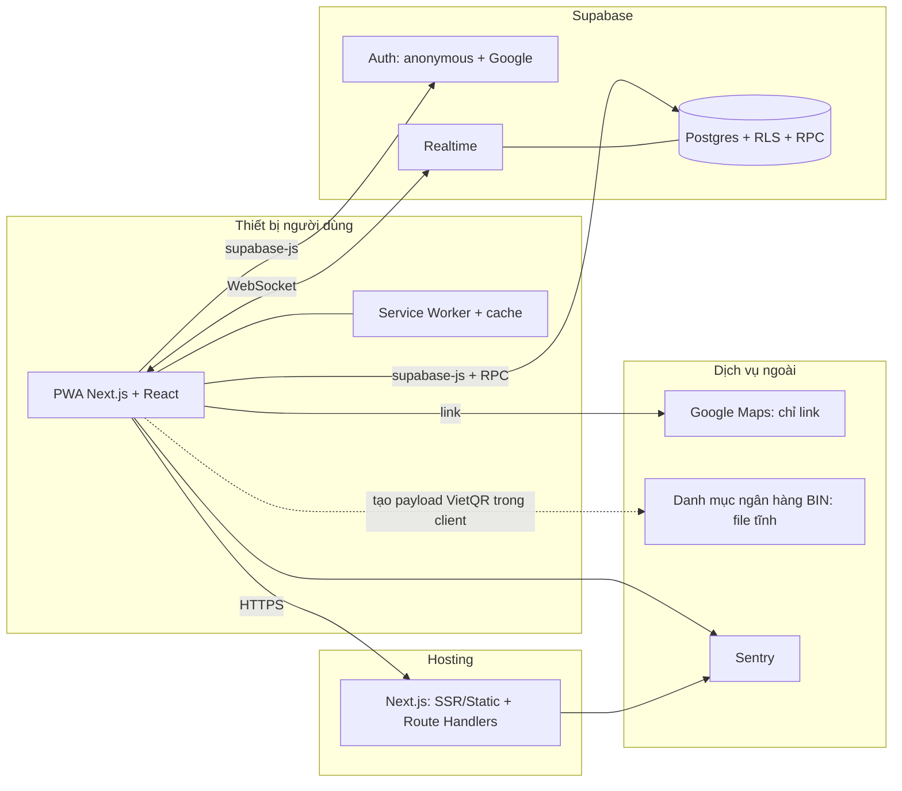
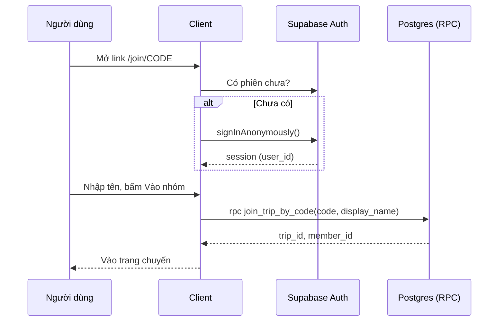

# Tripmate — Kiến trúc hệ thống

- **Mục đích:** Chốt kiến trúc kỹ thuật cho MVP: thành phần, công nghệ, xác thực, realtime, PWA, bảo mật, giới hạn gói free và vận hành.
- **Phiên bản:** 0.1
- **Cập nhật lần cuối:** 18/11/2026

## Tóm tắt

Kiến trúc là một ứng dụng Next.js (TypeScript) nói chuyện trực tiếp với Supabase (Postgres + Auth + Realtime + RLS), không có backend riêng. Logic nhạy cảm (tham gia bằng mã, tính số dư, lấy thông tin thanh toán) nằm trong hàm RPC của Postgres để bảo vệ bằng RLS. Thuật toán chia tiền và tạo VietQR là code TypeScript thuần, có test, dùng chung giữa client và test. Giới hạn gói free đủ cho khoảng 4.000 chuyến, nhưng có **hai điểm cần xử lý sớm**: dự án Supabase free bị tạm dừng sau 7 ngày không hoạt động, và **Vercel Hobby cấm dùng thương mại** (xem mục 9.3).

> Số liệu giới hạn dưới đây tổng hợp từ các bài viết năm 2026 và có thể đã đổi. Hãy xác nhận tại supabase.com/pricing và vercel.com/pricing trước khi chốt.

---

## 1. Sơ đồ tổng quan



Lưu ý: VietQR được tạo hoàn toàn ở client (payload EMVCo tự tính CRC), không gọi dịch vụ ngoài, nên không rò rỉ số tiền/tài khoản cho bên thứ ba và hoạt động offline.

---

## 2. Lựa chọn công nghệ và phương án thay thế

| Thành phần | Lựa chọn | Lý do | Phương án đã cân nhắc |
|------------|----------|-------|----------------------|
| Framework | Next.js (App Router) + TypeScript | Hệ sinh thái lớn, PWA, SSR cho trang giới thiệu | Vite + React SPA (đơn giản hơn nhưng mất SSR cho landing); SvelteKit (ít tài liệu cho dev solo hơn) |
| UI | Tailwind + shadcn/ui | Nhanh, tùy biến, đạt a11y mặc định | Mantine, MUI (nặng hơn) |
| Backend | Supabase | Postgres + Auth ẩn danh + Realtime + RLS trong một chỗ, gói free | Firebase (không có SQL, truy vấn nợ phức tạp khó hơn); PocketBase (tự host, tốn vận hành); tự viết API (tốn công cho solo dev) |
| Xác thực | Supabase Auth: anonymous + Google | Hỗ trợ nâng cấp ẩn danh lên Google giữ nguyên user id | Magic link email (cần email, thêm bước) |
| Realtime | Supabase Realtime (Postgres Changes) | Có sẵn, đủ cho nhóm nhỏ | Polling (đơn giản nhưng chậm); Broadcast tùy chỉnh (phức tạp hơn) |
| State client | TanStack Query | Cache, lạc quan, invalidation bằng realtime | Redux/Zustand (dư thừa) |
| Form/validation | React Hook Form + Zod | Dùng lại schema giữa client và test | — |
| Kéo thả | dnd-kit | Hỗ trợ cảm ứng và a11y | react-beautiful-dnd (không còn được bảo trì tích cực) |
| Test | Vitest, Playwright, pgTAP hoặc script RLS | Xem `09` | Jest (nặng hơn) |
| Giám sát lỗi | Sentry (gói free) | Đủ cho MVP | LogRocket (đắt) |
| Hosting | Xem mục 9.3 | — | Vercel, Cloudflare Pages, Netlify |

---

## 3. Cấu trúc thư mục dự án

```
tripmate/
├─ app/                      # Next.js App Router
│  ├─ (marketing)/page.tsx   # Landing (SEO)
│  ├─ join/[code]/page.tsx   # S03, S04
│  ├─ trips/
│  │  ├─ page.tsx            # S01
│  │  ├─ new/page.tsx        # S02
│  │  └─ [tripId]/
│  │     ├─ layout.tsx       # header + tabs
│  │     ├─ page.tsx         # Tổng quan (S05)
│  │     ├─ ideas/           # S06, S07
│  │     ├─ itinerary/       # S08
│  │     ├─ expenses/        # S09, S10, S11
│  │     └─ settle/          # S12, S13
│  └─ account/               # S16, S17
├─ components/ui/            # shadcn/ui
├─ features/
│  ├─ trips/ ideas/ itinerary/ expenses/ settlement/
│  └─ (mỗi feature: components, hooks, queries, schema)
├─ lib/
│  ├─ supabase/              # client, server, middleware
│  ├─ money/                 # format VND, parse
│  ├─ settlement/            # split.ts, balances.ts, simplify.ts (thuần, có test)
│  ├─ vietqr/                # payload.ts, crc16.ts, banks.json
│  └─ i18n/vi.ts             # toàn bộ chuỗi tiếng Việt
├─ supabase/
│  ├─ migrations/            # SQL đánh số
│  ├─ seed.sql
│  └─ tests/                 # kiểm thử RLS
├─ e2e/                      # Playwright
├─ public/                   # manifest, icon, service worker
└─ docs/                     # bộ tài liệu này
```

---

## 4. Luồng xác thực

### 4.1 Tổng quan



### 4.2 Nâng cấp ẩn danh lên Google

Dùng liên kết danh tính (`linkIdentity`) với phiên ẩn danh hiện có. **Không đổi `user_id`**, nên mọi `trip_members` vẫn đúng và không cần hợp nhất. Đây là đường đi chính và đơn giản nhất.

### 4.3 Hai trường hợp cần "hợp nhất"

| Trường hợp | Nguyên nhân | Giải pháp |
|-----------|-------------|-----------|
| **Nhận thành viên ảo** | Thành viên ảo chỉ là dòng `trip_members` không có `user_id` | RPC `claim_member(member_id)`: gán `user_id = auth.uid()`; chống đua bằng cập nhật có điều kiện `WHERE user_id IS NULL` |
| **Đăng nhập Google trên máy mới khi đã có tài khoản Google cũ** | `linkIdentity` thất bại vì Google đã gắn với user khác; hoặc người dùng đăng nhập Google thẳng, tạo user mới | RPC `merge_user(old_user_id)` chạy sau khi xác minh cả hai phiên (phiên ẩn danh cũ còn hiệu lực), chuyển `trip_members.user_id` sang user mới. Phức tạp nên xếp **Should/Phase 5** |

### 4.4 Khôi phục phiên ẩn danh (FR-36)

Phiên ẩn danh mất khi xóa cookie/đổi máy. Giải pháp theo thứ tự:

1. Nhắc nâng cấp Google sau khoản chi đầu tiên (UX-02).
2. Mở lại link mời, chọn "Tôi là…" từ danh sách thành viên **chưa nâng cấp Google**. Để chống mạo danh, thành viên đang có phiên hoạt động gần đây cần được xác nhận bởi chính họ hoặc owner (BR-09), và nhóm hiển thị thông báo "Đức vừa vào từ thiết bị mới".
3. Owner có thể tạo "link khôi phục cá nhân" dùng một lần cho một thành viên.

Rủi ro còn lại được ghi trong `Câu hỏi mở`.

### 4.5 Chống lạm dụng phiên ẩn danh

Bật CAPTCHA cho đăng nhập ẩn danh, giới hạn tốc độ theo IP của Supabase, và theo dõi tăng đột biến số user ẩn danh. Hạn mức MAU 50.000 của gói free tính cả người dùng ẩn danh.

---

## 5. Chiến lược Realtime

| Bảng | Subscribe? | Lý do |
|------|-----------|-------|
| `expenses`, `expense_splits` | Có | Số dư thay đổi ngay khi người khác nhập |
| `idea_votes`, `ideas` | Có | Vote thấy ngay |
| `date_votes`, `date_poll_options` | Có | Poll ngày |
| `itinerary_items` | Có | Sắp xếp lịch trình |
| `trip_members` | Có | Thành viên mới vào |
| `settlements` | Có | Thanh toán đã đánh dấu |
| `expense_history`, `member_bank_accounts` | Không | Không cần realtime, tăng tải và rủi ro riêng tư |

**Cách làm:** Mỗi trang chuyến chỉ mở **một kênh** theo `trip_id` (lọc `trip_id=eq.<id>`) và khi nhận sự kiện thì **invalidate** truy vấn TanStack Query tương ứng, thay vì tự vá dữ liệu cục bộ. Đơn giản và ít lỗi hơn.

**Tránh xung đột dữ liệu:**

- Sửa khoản chi dùng khóa lạc quan: cột `version`; `UPDATE ... WHERE id = ? AND version = ?`. Nếu 0 hàng thay đổi thì báo xung đột (EC-05).
- Thứ tự lịch trình dùng cột `position` kiểu `numeric` (kiểu "fractional indexing") để chèn giữa mà không phải đánh số lại cả danh sách; có tác vụ chuẩn hóa định kỳ nếu cần.
- Vote là bản ghi riêng cho mỗi (member, idea) nên không xung đột.
- Số dư không lưu sẵn; luôn tính từ dữ liệu gốc (hàm `get_trip_balances`) để không bị lệch.

**Giới hạn:** gói free khoảng 200 kết nối đồng thời và 2 triệu thông điệp mỗi tháng (xem mục 9).

---

## 6. Chiến lược PWA và Offline

| Hạng mục | Quyết định |
|----------|-----------|
| Manifest | Tên, icon, `display: standalone`, `lang: vi`, màu chủ đạo |
| Service worker | Cache tài nguyên tĩnh (app shell); cache `stale-while-revalidate` cho truy vấn đọc của chuyến |
| Offline đọc (NFR-10, Must) | Lịch trình, danh sách khoản chi và số dư đã tải gần nhất xem được khi mất mạng; hiển thị dải "Đang offline" |
| Offline ghi (NFR-11, Should) | Hàng đợi ghi khoản chi cục bộ (IndexedDB), gửi lại khi có mạng, mỗi khoản có khóa chống trùng (`client_id` UUID) để không tạo bản sao |
| Cài về màn hình chính | Gợi ý cài sau lần dùng có giá trị; iOS cần hướng dẫn thủ công (Chia sẻ, rồi Thêm vào màn hình chính) |
| Push notification | **Hoãn** (iOS PWA hạn chế, thêm độ phức tạp) |
| Cập nhật | Thông báo "Có phiên bản mới" khi service worker mới sẵn sàng |

Xung đột khi đồng bộ hàng đợi: khoản chi mới không xung đột (chỉ chèn); chỉnh sửa offline sẽ bị chặn trong MVP.

---

## 7. Quản lý trạng thái và cache phía client

- **Dữ liệu máy chủ:** TanStack Query, khóa truy vấn theo `['trip', tripId, 'expenses']`. Thời gian `staleTime` ngắn (ví dụ 30 giây), dựa vào realtime để làm mới.
- **Cập nhật lạc quan:** thêm khoản chi, vote, đánh dấu đã trả đều hiện ngay và hoàn tác khi lỗi.
- **Trạng thái UI cục bộ:** React state; nhớ lựa chọn gần nhất (người trả, kiểu chia) trong `localStorage`.
- **Phiên:** Supabase lưu phiên; middleware Next.js làm mới token.
- **Tính toán:** tính số dư và gợi ý quyết toán **ở client** từ dữ liệu đã tải bằng hàm thuần (nhanh, dùng được offline), và đối chiếu với `get_trip_balances` ở phía DB trong kiểm thử để đảm bảo cả hai khớp.

---

## 8. Bảo mật

### 8.1 RLS

Mọi bảng bật RLS; không bảng nào cho phép truy cập chỉ dựa vào `anon` key. Quy tắc chung: **chỉ thành viên đang hoạt động của chuyến mới đọc/ghi dữ liệu chuyến**. Chi tiết SQL trong `07-database.md`.

### 8.2 Link mời

- Mã `invite_code` ngẫu nhiên từ nguồn an toàn, 12 ký tự (base32), không đoán được.
- Tham gia **chỉ qua RPC** `join_trip_by_code` (SECURITY DEFINER); không có policy cho phép liệt kê chuyến theo mã.
- Giới hạn tốc độ thử mã sai theo IP/người dùng; owner có thể đổi mã hoặc tắt nhận thành viên.
- Giới hạn số thành viên mỗi chuyến (D-08).

### 8.3 Giới hạn tốc độ và chống lạm dụng

CAPTCHA cho phiên ẩn danh; giới hạn tạo chuyến mỗi người dùng/ngày; giới hạn kích thước chuỗi; kiểm tra bằng ràng buộc CHECK ở DB, không chỉ validate ở client.

### 8.4 Dữ liệu ngân hàng (NFR-08)

- Bảng `member_bank_accounts` **không có policy SELECT** cho người khác. Chủ tài khoản mới đọc/sửa được dữ liệu của mình.
- Người cần chuyển tiền lấy thông tin qua RPC `get_payment_target(trip_id, to_member_id)` chỉ trả dữ liệu khi người gọi **thực sự là người nợ** trong chuyến đó (kiểm tra số dư âm, hoặc có giao dịch đề xuất).
- Không ghi số tài khoản vào log, Sentry hay analytics (lọc trước khi gửi).
- Cân nhắc mã hóa ở mức cột trong giai đoạn sau; hiện tại dựa vào RLS và RPC.

### 8.5 Quyền riêng tư

Thu thập tối thiểu: tên hiển thị, thông tin nhận tiền tùy chọn. Chính sách riêng tư tiếng Việt, chức năng xóa/ẩn danh hóa dữ liệu của mình (NFR-09). Cần rà soát quy định bảo vệ dữ liệu cá nhân hiện hành tại Việt Nam trước khi ra mắt công khai (xem `Câu hỏi mở`).

### 8.6 Khác

HTTPS bắt buộc; header bảo mật (CSP, X-Frame-Options); không đưa `service_role` key vào client; secret chỉ ở biến môi trường của host.

---

## 9. Giới hạn gói free, ước tính tải, khi nào nâng cấp

### 9.1 Supabase Free (tổng hợp từ các nguồn 2026)

| Tài nguyên | Giới hạn free | Tác động với Tripmate |
|-----------|---------------|------------------------|
| Dung lượng DB | 500 MB mỗi dự án | Xem ước tính 9.2 |
| Băng thông (egress) | 5 GB/tháng | Thường đủ vì dữ liệu văn bản nhỏ |
| MAU Auth | 50.000 (tính cả ẩn danh) | Cần theo dõi nếu lan truyền nhanh |
| Realtime | khoảng 200 kết nối đồng thời, khoảng 2 triệu thông điệp/tháng | Giới hạn thực tế đầu tiên khi nhiều nhóm dùng cùng lúc |
| Lưu trữ file | 1 GB | Dùng cho ảnh hóa đơn (hoãn) |
| **Tự tạm dừng** | **Sau 7 ngày không hoạt động** | Nguy hiểm nếu giai đoạn thử nghiệm yên ắng |
| Backup | Không có backup tự động ở gói free | Phải tự backup |

### 9.2 Ước tính tải

Giả định một chuyến trung bình: 6 thành viên, 40 khoản chi, 90 dòng chia, 10 ý tưởng, 60 vote, 15 hoạt động lịch trình. Kích thước ước tính cả chỉ mục khoảng 100–150 KB.

| Chỉ số | Ước tính |
|--------|----------|
| Số chuyến trong 500 MB | khoảng 3.500 đến 5.000 chuyến |
| Kết nối realtime đồng thời | Mỗi chuyến đang dùng khoảng 3–5 người; 200 kết nối là khoảng 40–60 chuyến cùng lúc |
| Báo động nâng cấp | DB đạt 400 MB; realtime đạt 150 kết nối đỉnh; MAU đạt 40.000 |

### 9.3 Hosting và điều khoản thương mại (quan trọng)

Gói **Vercel Hobby chỉ dành cho dự án cá nhân, phi thương mại** (giới hạn khoảng 100 GB băng thông, 1 người dùng; các nguồn 2026 nhất quán về điểm này). Gói Pro là 20 USD/người/tháng. Mô hình thu nhập ở `01-product-brief.md` (affiliate, quảng cáo, có thể cả donate) sẽ **vi phạm** điều khoản Hobby khi bật.

| Phương án | Ưu | Nhược |
|-----------|----|-------|
| A. Vercel Hobby cho MVP, chuyển host trước khi thu tiền | Triển khai Next.js dễ nhất | Phải di chuyển; nguy cơ quên |
| B. Cloudflare Pages/Workers ngay từ đầu | Cho phép thương mại ở gói free (theo một nguồn 2026), băng thông rộng rãi | Next.js trên Cloudflare cần adapter, có thể có điểm khác biệt khi chạy |
| C. Netlify | Cho phép thương mại ở gói free (theo nguồn 2026) | Hạn mức tín dụng; Next.js có độ tương thích riêng |
| D. Vercel Pro | Ít rủi ro kỹ thuật nhất | 20 USD/tháng, trái ràng buộc "miễn phí hạ tầng" |

**Đề xuất:** Phương án A cho đến hết thử nghiệm kín (chưa có doanh thu); đặt mốc "chuyển sang B hoặc C trước khi bật bất kỳ nguồn thu nào". Giữ code không phụ thuộc tính năng độc quyền của Vercel để di chuyển rẻ. Cần kiểm chứng lại điều khoản trước khi quyết định cuối.

### 9.4 Khi nào nâng cấp

| Tín hiệu | Hành động |
|----------|-----------|
| Cần chạy ổn định 24/7 hoặc có người dùng thật | Supabase Pro (khoảng 25 USD/tháng) để bỏ tự tạm dừng và có backup hằng ngày |
| DB gần 400 MB | Dọn dữ liệu chuyến cũ (lưu trữ) hoặc nâng cấp |
| Realtime gần trần | Giảm kênh (chỉ subscribe tab đang mở), hoặc nâng cấp |
| Bắt đầu có doanh thu | Chuyển host theo mục 9.3 |

### 9.5 Giữ dự án Supabase không bị tạm dừng

Lịch GitHub Actions hằng ngày gọi một truy vấn nhẹ tới dự án (ví dụ endpoint `/health` qua RPC). Đồng thời lịch hằng tuần chạy `pg_dump` và lưu bản sao ngoài (artifact riêng hoặc kho lưu trữ riêng tư).

---

## 10. CI/CD, môi trường, giám sát

| Chủ đề | Quyết định |
|--------|-----------|
| Môi trường | **dev** (Supabase local bằng CLI + Docker), **staging** (một dự án Supabase free riêng), **prod** (dự án Supabase free thứ hai). Gói free cho 2 dự án hoạt động nên staging và prod chiếm hết hạn mức |
| Migration | Tệp SQL đánh số trong `supabase/migrations`, áp dụng bằng CLI qua CI; không sửa tay trên prod |
| CI (GitHub Actions) | Lint, type-check, unit (Vitest), kiểm thử RLS trên Supabase local, E2E Playwright trên preview |
| CD | `main` tự triển khai lên staging; gắn thẻ phát hành thì lên prod (có phê duyệt tay) |
| Giám sát lỗi | Sentry free (client và server), lọc dữ liệu nhạy cảm |
| Analytics | Tối giản, không cookie theo dõi, ưu tiên riêng tư (xem `10`) |
| Uptime | Dịch vụ ping miễn phí (kèm tác dụng giữ Supabase hoạt động) |
| Secrets | Biến môi trường trên host và GitHub Secrets |

---

## Câu hỏi mở

1. Cách khôi phục danh tính ẩn danh nào vừa an toàn vừa không gây ma sát (mục 4.4)? Có chấp nhận rủi ro mạo danh trong nhóm bạn thân ở MVP không?
2. Quy định về dữ liệu cá nhân tại Việt Nam hiện nay (luật mới có hiệu lực từ 2026) đòi hỏi gì với tên và số tài khoản? Cần tư vấn hoặc đọc nguồn chính thức.
3. Có cần hợp nhất tài khoản khi đăng nhập Google trên máy mới (mục 4.3) ở MVP, hay hoãn?
4. Dùng 2 dự án Supabase free cho staging và prod có đủ, hay dùng Supabase local làm staging và để 1 dự án dự phòng?
5. Điều khoản Cloudflare/Netlify bản free về thương mại có đúng như các nguồn nói không? Cần đọc điều khoản chính thức.
6. Danh mục BIN ngân hàng lấy từ đâu và cập nhật thế nào (file tĩnh tự duy trì hay nguồn công khai)?

## Quyết định cần chốt

| ID | Quyết định | Đề xuất |
|----|-----------|---------|
| D-20 | Hosting cho MVP và mốc chuyển | Vercel Hobby tới hết thử nghiệm kín; chuyển trước khi có doanh thu (xem D-01) |
| D-21 | Tạo VietQR ở client, không gọi dịch vụ ngoài | Có |
| D-22 | Tính số dư ở client hay DB | Cả hai: client để hiển thị nhanh; RPC `get_trip_balances` để kiểm chứng và làm nguồn chuẩn |
| D-23 | Backup | Hằng tuần `pg_dump` bằng GitHub Actions |
| D-24 | Push notification | Hoãn sau MVP |
| D-25 | Hợp nhất tài khoản (merge_user) | Hoãn sang Phase 5 hoặc sau |
