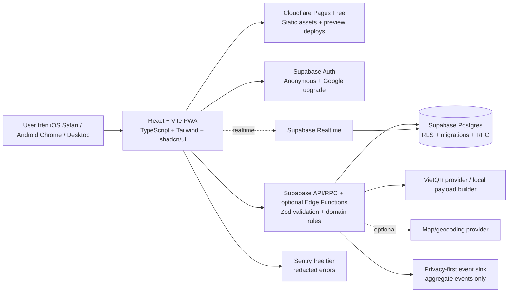
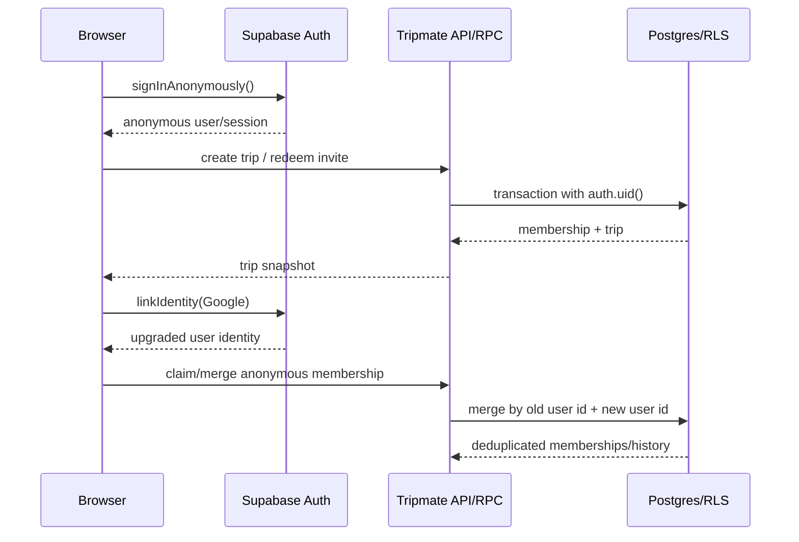

# Tripmate — System Architecture

**Mục đích:** Mô tả kiến trúc triển khai, luồng dữ liệu, xác thực, realtime, offline, bảo mật, chi phí và vận hành cho MVP Tripmate.

**Phiên bản:** 0.1

**Cập nhật lần cuối:** 2026-11-17

**Tóm tắt:** Tripmate dùng React + Vite + TypeScript làm web/PWA, Cloudflare Pages Free làm static hosting và Supabase làm Postgres/Auth/Realtime/RLS. Client gọi Supabase API/RPC hoặc Edge Functions cho mutation; dữ liệu private được bảo vệ ở RLS. Docker dùng cho local/CI và build reproducible, không phải runtime production trên Cloudflare Free. VietQR và map là integration tùy chọn có fallback copy/manual.

## 1. Sơ đồ tổng quan



### Luồng request chính

1. Browser tải static PWA shell từ Cloudflare Pages.
2. Supabase client khôi phục anonymous session hoặc tạo session khi cần.
3. Query read dùng Supabase client với RLS cho dữ liệu không cần domain orchestration.
4. Mutation đi qua Supabase RPC/Edge Function hoặc transaction được bảo vệ bằng RLS: validate input, kiểm tra membership/role, trả domain error đã chuẩn hóa.
5. Supabase Realtime phát event cho trip đang mở; client invalidate query và refetch snapshot thay vì tự merge mọi field.
6. QR được tạo từ validated payment profile + transfer snapshot; không ghi raw payload vào analytics.

## 2. Lý do chọn công nghệ và phương án thay thế

| Thành phần | Lựa chọn | Lý do | Phương án thay thế đã cân nhắc | Khi nào đổi |
|---|---|---|---|---|
| Web framework | React + Vite + TypeScript | Build static nhanh, phù hợp PWA và Cloudflare Pages; private app không cần SSR | Next.js + vinext, React Router | Khi cần SSR/SEO động hoặc muốn dùng Cloudflare Workers runtime. |
| UI | Tailwind + shadcn/ui | Tạo mobile UI nhanh, component source-owned, accessibility baseline | CSS Modules, MUI | Nếu design system cần theme runtime hoặc component enterprise. |
| Database | Supabase Postgres | SQL mạnh cho relational money data, migrations, RLS, RPC | Neon + Drizzle, Firebase | Khi cần scale/workload khác hoặc RLS không đủ. |
| Auth | Supabase Auth anonymous + Google | Đúng yêu cầu join không login; upgrade identity cùng hệ | Clerk, Auth.js | Nếu cần nhiều provider/organization phức tạp. |
| Realtime | Supabase Realtime | Đủ cho trip nhỏ; tích hợp cùng DB | Pusher/Ably, WebSocket riêng | Khi fan-out, presence hoặc quota không phù hợp. |
| Client state | TanStack Query + local UI state | Cache/invalidation rõ; tránh global store lớn | SWR, Zustand | Khi domain state offline phức tạp hơn. |
| Validation | Zod dùng chung client/server | Schema đồng nhất, error field-level | Valibot, Yup | Chỉ khi bundle/perf bắt buộc. |
| Hosting | Cloudflare Pages Free | Static assets, Git preview deployments, CDN và free tier phù hợp MVP | Vercel, Netlify | Khi cần SSR/Workers-specific runtime hoặc Pages limits không đủ. |
| Docker | Dockerfile + Compose | Local Supabase/app parity, CI build/lint/test, portable artifact | Devcontainer | Không dùng Docker container runtime trên Cloudflare Free; Cloudflare Containers là paid. |
| QR | VietQR payload builder hoặc provider | Core settlement có fallback copy; không khóa vào một provider | Tự encode EMVCo toàn bộ, NAPAS integration | Khi cần guaranteed bank coverage/monitoring. |
| Map | Không bắt buộc, link Google Maps/OSM trước | Giảm API key/cost; itinerary vẫn chạy | Mapbox, Google Maps API | Khi người dùng cần search/geocoding có cấu trúc. |
| Error monitoring | Sentry free | Stack trace + release + breadcrumbs, có scrub data | Cloudflare logs | Khi cần retention/alerting cao hơn. |

## 3. Cấu trúc thư mục dự án

```text
.
├─ src/
│  ├─ app/                         # providers, layouts, route wiring
│  ├─ pages/                       # route-level screens
│  ├─ components/                  # shadcn/ui + shared UI
│  ├─ features/                    # trips, polls, itinerary, expenses, settlement
│  ├─ lib/                         # Supabase, validation, money, QR, analytics
│  └─ main.tsx
├─ tests/
│  ├─ unit/                        # algorithms, validation
│  ├─ integration/                 # RPC, RLS, repository
│  └─ e2e/                         # Playwright journeys
├─ supabase/
│  ├─ migrations/
│  ├─ seed.sql
│  └─ functions/                   # only if Edge Function needed
├─ public/
│  ├─ icons/
│  └─ screenshots/
├─ Dockerfile                      # local/CI build, not Cloudflare runtime
├─ docker-compose.yml              # optional local app + tooling
├─ vite.config.ts
├─ wrangler.toml                   # optional Pages tooling
├─ docs/
├─ .env.example
└─ package.json
```

## 4. Luồng xác thực và identity



### Quy tắc identity

| ID | Quy tắc |
|---|---|
| ARCH-AUTH-01 | Anonymous user là Supabase `auth.users` identity thật, không lưu password/email giả trong app table. |
| ARCH-AUTH-02 | `trip_members.user_id` nullable cho virtual member; `virtual_member_id`/flag phân biệt member ảo. |
| ARCH-AUTH-03 | Upgrade identity phải atomic; nếu Google account đã có member trong cùng trip thì merge, không duplicate. |
| ARCH-AUTH-04 | Không dùng invite code như authentication credential sau khi redeem; membership + session mới cấp quyền. |
| ARCH-AUTH-05 | Nếu session mất, app không tự đoán member bằng display name; chỉ hướng dẫn sign-in/recovery hoặc owner mời lại. |

## 5. Realtime strategy

| Bảng/scope | Subscribe? | Lý do/cách xử lý |
|---|---|---|
| `trip_members` | Có trong Members/Overview | Cập nhật joined/pending; khi event tới invalidate member query. |
| `polls`, `poll_options`, `poll_votes` | Có trong Poll | Vote/lock cần phản hồi nhanh; refetch poll aggregate sau event. |
| `itinerary_days`, `itinerary_items` | Có trong Itinerary | Reorder/add cần thấy; client không tự cộng order nếu event thiếu. |
| `expenses`, `expense_participants` | Có trong Expense/Settlement | Event invalidate expense list + balance; không truyền raw bank data. |
| `settlement_transfers` | Có trong Settlement/Transfer | Status timeline cập nhật; refetch snapshot khi expense revision. |
| `audit_events` | Không subscribe toàn bộ | Chỉ owner/admin query phân trang khi mở history. |

### Tránh xung đột

- Client lưu `updated_at` hoặc `row_version` và gửi version khi update.
- Server reject stale update bằng `409`/domain error; client hiển thị lựa chọn reload.
- Realtime event chỉ là signal invalidate, không phải nguồn sự thật cuối cùng.
- Drag/drop reorder dùng transaction cập nhật các `position` trong cùng ngày.
- Mutation có idempotency key cho action dễ retry (redeem invite, create expense).
- Khi tab hidden, unsubscribe hoặc giảm subscription; khi visible refetch snapshot.

## 6. PWA và offline

| Phần | Hành vi |
|---|---|
| App shell | Cache JS/CSS/icons và landing assets bằng service worker. |
| Public join | Không cache private trip response lâu; invite preview có TTL ngắn. |
| Read cache | TanStack Query persist có giới hạn, mã hóa không được coi là security boundary; badge stale bắt buộc. |
| Draft | Expense draft lưu local theo `tripId + userId`, không tự gửi khi online lại. |
| Write offline | Không submit expense/poll offline trong MVP; UI nói rõ để tránh duplicate. |
| Update | Service worker update có prompt mềm; không clear local drafts khi deploy version mới. |

Offline write chỉ được bật sau khi có client-generated idempotency key, outbox, retry/backoff, conflict UI và test mất mạng giữa request/response.

## 7. Quản lý trạng thái và cache client

| Loại state | Công cụ/nguyên tắc |
|---|---|
| Server state | TanStack Query theo key `trip`, `members`, `polls`, `itinerary`, `expenses`, `settlement`; invalidation sau mutation. |
| Form state | React Hook Form + Zod; draft trong memory/local storage theo sensitivity. |
| UI state | Local React state: sheet open, selected tab, filters, confirm dialog. |
| Auth state | Supabase client/session listener; không copy access token vào app store. |
| Money | `bigint`/integer string qua JSON; không dùng JS floating point cho calculation. |
| URL state | `tripId`, tab, pollId, filter không nhạy cảm; không để raw account info hoặc invite secret trong query. |

## 8. Bảo mật và quyền riêng tư

| ID | Control | Thiết kế |
|---|---|---|
| SEC-01 | RLS | Mọi private table có policy dựa trên active membership; owner policy tách khỏi member policy. |
| SEC-02 | Server validation | Zod/schema + domain checks; không tin `role`, `payer_id`, `trip_id` từ client. |
| SEC-03 | Invite abuse | Token random đủ dài, hash token nếu lưu, TTL/revoke, rate limit theo IP/session, không enumerate trip. |
| SEC-04 | Bank privacy | Bank details encrypted at rest bởi provider; app chỉ fetch fields cần render transfer; redact logs/analytics. |
| SEC-05 | XSS/content | Note/display name render escaped; link location validate scheme; không cho arbitrary HTML. |
| SEC-06 | Session/API | Dùng Supabase client/session APIs, RLS/RPC và Edge Function validation; không đặt secret trong client bundle. |
| SEC-07 | Abuse/quota | Limit payload length, member/expense count, invite redemption và expensive settlement calls. |
| SEC-08 | Audit | Lock poll, role change, expense void/edit, transfer status lưu actor/timestamp/action; không lưu raw secret. |
| SEC-09 | Data deletion | Soft delete nghiệp vụ, user data export/delete workflow trước public launch; retention document phải rõ. |

## 9. Free tier, tải và ngưỡng nâng cấp

Các giới hạn nhà cung cấp thay đổi theo thời gian; bảng dưới là operational budget để MVP tự bảo vệ, không phải cam kết quota. Cloudflare Pages Free hiện có giới hạn build/file cần theo dõi; static asset là lựa chọn chính để tránh phụ thuộc Pages Functions.

| Hạng mục | Giả định MVP | Guardrail |
|---|---|---|
| Active trip | 100–500 trip lũy kế trong pilot | Archive trip completed; paginate data. |
| Member/trip | ≤10 Must, soft limit 20 | Reject vượt limit với message; không query toàn bộ users. |
| Expense/trip | ≤500 | Paginate; aggregate bằng SQL/RPC. |
| Realtime | Chỉ tab active, trip scope | Unsubscribe hidden tabs; không broadcast toàn workspace. |
| Storage | Không upload receipt trong MVP | Chỉ lưu URL/note; OCR/ảnh để phase sau. |
| Server runtime | API nhẹ, settlement SQL/TypeScript bounded | Không chạy job dài trong request; precompute snapshot khi cần. |
| Bandwidth | PWA asset cache, JSON pagination | Không gửi raw full history mỗi event. |

Theo tài liệu Cloudflare hiện tại, Pages Free có giới hạn 500 builds/tháng, 20.000 files/site và 25 MiB/file; nếu dùng Pages Functions, request được tính vào quota Workers Free. Xem [Pages limits](https://developers.cloudflare.com/pages/platform/limits/) và [Pages Functions pricing](https://developers.cloudflare.com/pages/functions/pricing/). Các con số này cần xác minh lại khi triển khai.

### Khi phải nâng cấp

- Database/storage/bandwidth đạt 70% quota hai tuần liên tiếp.
- Realtime disconnect hoặc latency ảnh hưởng >5% active sessions.
- Sentry/event retention không đủ để debug P1.
- Cần background jobs, file storage lớn, bank/payment integration hoặc traffic public vượt dự báo.

## 10. CI/CD, môi trường và monitoring

| Môi trường | Dữ liệu | Deploy | Quy tắc |
|---|---|---|---|
| Local | Supabase local/seed giả | Dev command | Không dùng bank data thật. |
| Preview | Database branch/project riêng nếu có | Pull request/preview | RLS/test E2E smoke; secret riêng. |
| Staging | Dataset synthetic | Manual promote | Chạy migration + RLS/integration + mobile smoke. |
| Production | User data thật | Protected main/tag | Backup/migration review, Sentry release, quota check, rollback plan. |

### Pipeline tối thiểu

1. Pull request: format/lint/typecheck/unit test.
2. Migration lint + RLS/integration test với hai user và hai trip.
3. Playwright smoke create → join → expense → settlement.
4. Preview deploy; review accessibility bằng keyboard/axe.
5. Merge main: deploy production sau approval; migration chạy trước app code cần schema mới.

### Observability

- Events: `trip_created`, `invite_opened`, `member_joined`, `poll_locked`, `expense_created`, `settlement_viewed`, `transfer_marked_paid`, `trip_completed`.
- Không gửi tên, note, amount chi tiết, account number, raw token vào analytics.
- Sentry tag `release`, browser family, route, correlation id; scrub request body.
- Dashboard tối thiểu: 5xx, p95 API/read, join conversion, expense save failure, settlement recompute failure, quota.

## 11. Docker và Cloudflare deployment

### Vai trò của Docker

Docker không phải production runtime của Cloudflare Pages Free. Docker được dùng để:

- chạy local build/test giống CI;
- đóng gói artifact build để kiểm tra trước khi push;
- chạy Supabase CLI/tooling local nếu cần;
- giữ phương án chuyển sang Cloud Run/Render/Fly.io hoặc VPS sau này mà không đổi code frontend.

Docker image không được chứa Supabase service key, Google OAuth secret, bank data hoặc dữ liệu production.

### Cloudflare Pages deployment

| Thiết lập | Giá trị |
|---|---|
| Framework | React/Vite |
| Install command | `npm ci` |
| Build command | `npm run build` |
| Output directory | `dist` |
| Production branch | `main` |
| Preview | Pull request deployment tự động |
| Public variables | `VITE_SUPABASE_URL`, `VITE_SUPABASE_ANON_KEY` |
| Secret variables | Chỉ đặt ở Supabase/Edge Function; không đưa vào `VITE_*` |

Luồng CI/CD:

```text
Pull Request
  ├─ npm ci / lint / typecheck / unit / build
  ├─ Docker build --target ci (không push production)
  ├─ Playwright smoke
  └─ Cloudflare Pages preview

main
  ├─ Supabase migration review/apply
  ├─ npm ci → npm run build → dist
  └─ Cloudflare Pages production deploy
```

Nếu sau này cần SSR hoặc Docker runtime thật, chuyển frontend sang Cloudflare Workers/vinext hoặc một container host riêng; không cố nhét Node server vào Pages Free.

## Câu hỏi mở

1. Dùng Supabase Realtime Postgres Changes hay Broadcast cho aggregate event; quota/latency nào chấp nhận được?
2. Có cần tách Supabase project theo preview branch hay chỉ dùng một staging project với namespace dữ liệu?
3. VietQR payload tự build có đủ an toàn hay bắt buộc dùng provider chính thức cho MVP?
4. Có lưu `bank_account` encrypted trong DB hay chỉ yêu cầu nhập mỗi lần tạo QR?
5. Recovery anonymous session sẽ dựa trên Google upgrade, invite rejoin hay export code tạm thời?
6. Có cần file storage cho ảnh hóa đơn trong MVP không? Nếu có, retention và RLS bucket ra sao?
7. Khi nào triển khai map/geocoding thay vì chỉ lưu location text + external map URL?

## Quyết định cần chốt

| Mã | Quyết định | Đề xuất mặc định |
|---|---|---|
| DEC-ARCH-01 | Backend boundary | Supabase client cho query đơn giản; RPC/Edge Functions cho mutation có transaction/domain rule; không dùng Next.js Server Actions. |
| DEC-ARCH-02 | Realtime consistency | Event chỉ invalidate/refetch; DB snapshot là nguồn sự thật. |
| DEC-ARCH-03 | Offline | Read cache + local draft, không offline write trong MVP. |
| DEC-ARCH-04 | Map | Lưu location text + URL trước; không bắt API map để core flow chạy. |
| DEC-ARCH-05 | Bank data | Không log; fetch theo transfer context; QR action chủ động. |
| DEC-ARCH-06 | Preview data | Dùng dataset synthetic/project riêng; không đưa data production vào preview. |
