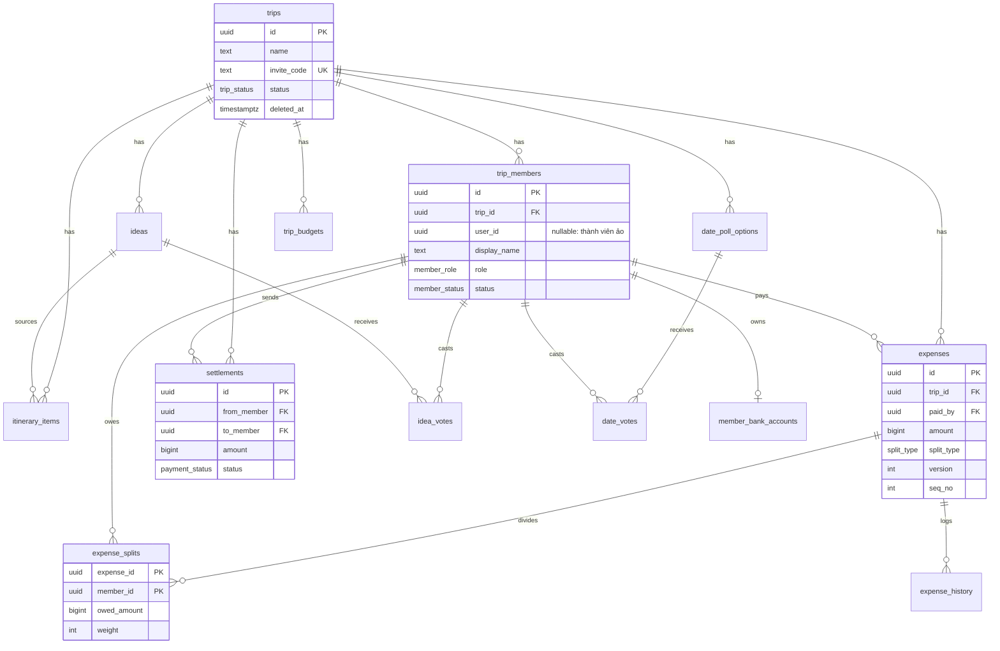

# Tripmate — Thiết kế cơ sở dữ liệu

- **Mục đích:** Định nghĩa lược đồ Postgres (Supabase), ràng buộc, chính sách RLS, hàm RPC, migration và cách xử lý trường hợp biên về dữ liệu.
- **Phiên bản:** 0.1
- **Cập nhật lần cuối:** 18/11/2026

## Tóm tắt

Lược đồ gồm 13 bảng. Tiền luôn là `bigint` (VND, không số thập phân). Số dư **không lưu sẵn** mà tính từ khoản chi, phần chia và thanh toán. Ghi dữ liệu quan trọng (tạo chuyến, tham gia, khoản chi, thanh toán) đi qua **RPC SECURITY DEFINER** để đảm bảo toàn vẹn (tổng phần chia = tổng khoản chi) và để RLS có thể chặt (client không INSERT/UPDATE trực tiếp các bảng tiền). Xóa là xóa mềm (`deleted_at`). SQL dưới đây là **bản nháp thiết kế**, cần chạy thử và kiểm thử trước khi dùng.

---

## 1. ERD



---

## 2. Quy ước

| Chủ đề | Quy ước |
|--------|---------|
| Tên | `snake_case`, bảng số nhiều, khóa chính `id uuid default gen_random_uuid()` |
| Thời gian | `timestamptz`, mặc định `now()`; `created_at`, `updated_at` |
| Xóa mềm | Cột `deleted_at timestamptz` ở bảng dữ liệu chính; mọi truy vấn và policy lọc `deleted_at is null` |
| Tiền | `bigint`, đơn vị đồng; ràng buộc CHECK dương và giới hạn trên |
| Phần trăm | Lưu theo **điểm cơ bản** (basis points) kiểu số nguyên: 33,33% = 3333; tổng phải bằng 10000 |
| Shares | Số nguyên dương |
| Khóa ngoại | `on delete restrict` mặc định (vì xóa mềm); dùng `cascade` chỉ khi xóa cứng theo yêu cầu xóa dữ liệu |

### Enum

```sql
create type member_role     as enum ('owner', 'member');
create type member_status   as enum ('active', 'left', 'removed');
create type trip_status     as enum ('active', 'locked', 'archived');
create type idea_kind       as enum ('destination', 'lodging', 'activity');
create type availability    as enum ('yes', 'maybe', 'no');
create type split_type      as enum ('equal', 'amount', 'percent', 'shares');
create type expense_category as enum ('lodging', 'transport', 'food', 'tickets', 'other');
create type payment_status  as enum ('marked_paid', 'confirmed');
```

`trip_status = 'locked'` nghĩa là đã "Chốt quyết toán" (FR-34).

---

## 3. Mô tả bảng

### 3.1 `trips`

| Cột | Kiểu | Ràng buộc | Ghi chú |
|-----|------|-----------|---------|
| id | uuid | PK | |
| name | text | not null, 1–80 ký tự | |
| destination | text | null | |
| start_date, end_date | date | null; `end_date >= start_date`; tối đa 30 ngày (BR-10) | |
| emoji | text | null | Bìa chuyến |
| invite_code | text | unique, not null, 12 ký tự | Sinh ngẫu nhiên, đổi được |
| invite_enabled | boolean | default true | Tắt nhận thành viên mới |
| status | trip_status | default 'active' | |
| created_at, updated_at, deleted_at | timestamptz | | |

Index: unique `invite_code`; `(deleted_at)` một phần.

### 3.2 `trip_members`

| Cột | Kiểu | Ràng buộc | Ghi chú |
|-----|------|-----------|---------|
| id | uuid | PK | Dùng làm tham chiếu ở mọi bảng khác (không dùng `user_id` trực tiếp) |
| trip_id | uuid | FK `trips`, not null | |
| user_id | uuid | null, FK `auth.users` | **null = thành viên ảo** |
| display_name | text | not null, 1–30 ký tự | |
| role | member_role | default 'member' | |
| status | member_status | default 'active' | `left`/`removed` vẫn giữ để tính nợ (EC-01) |
| created_at, joined_at, left_at, deleted_at | timestamptz | | |

Index/ràng buộc: unique `(trip_id, user_id)` where `user_id is not null`; index `(trip_id)`; mỗi chuyến đúng một `owner` (partial unique index `(trip_id) where role='owner' and deleted_at is null`).

### 3.3 `ideas`, `idea_votes`

`ideas`: `id`, `trip_id`, `kind idea_kind`, `title` (1–100), `note`, `url`, `estimated_cost bigint check (>=0)`, `created_by` (FK `trip_members`), `is_locked boolean default false`, `locked_at`, `created_at`, `deleted_at`. Index `(trip_id, kind)`.

`idea_votes`: PK `(idea_id, member_id)`, `created_at`. Mỗi thành viên tối đa một vote mỗi ý tưởng (FR-10).

### 3.4 `date_poll_options`, `date_votes`

`date_poll_options`: `id`, `trip_id`, `start_date`, `end_date`, `is_locked`, `created_by`, `created_at`, `deleted_at`; CHECK `end_date >= start_date`.

`date_votes`: PK `(option_id, member_id)`, `availability` (yes/maybe/no), `updated_at`.

### 3.5 `itinerary_items`

| Cột | Kiểu | Ghi chú |
|-----|------|---------|
| id, trip_id | uuid | |
| day_date | date | Ngày của hoạt động |
| position | numeric | Thứ tự trong ngày (fractional indexing) |
| start_time | time null | |
| title | text | 1–120 |
| location_text, maps_url, note | text null | |
| estimated_cost | bigint null | |
| idea_id | uuid null FK `ideas` | Liên kết nếu tạo từ ý tưởng |
| created_by, created_at, deleted_at | | |

Index `(trip_id, day_date, position)`.

### 3.6 `trip_budgets`

PK `(trip_id, category)`; `planned_amount bigint check (>= 0)`. Mỗi hạng mục (enum `expense_category`) một dòng dự toán.

### 3.7 `expenses`

| Cột | Kiểu | Ràng buộc | Ghi chú |
|-----|------|-----------|---------|
| id | uuid | PK | |
| trip_id | uuid | FK | |
| client_id | uuid | unique `(trip_id, client_id)` | Khóa chống trùng khi ghi offline và gửi lại |
| title | text | 1–100 | |
| amount | bigint | `check (amount between 1 and 1000000000)` | EC-07 |
| paid_by | uuid | FK `trip_members` | Có thể không nằm trong người chia (EC-08) |
| category | expense_category | default 'other' | |
| spent_on | date | default current_date | |
| split_type | split_type | not null | |
| note | text null | | |
| seq_no | integer | not null | Số thứ tự trong chuyến; dùng cho xoay vòng phần dư (xem `08`) |
| version | integer | default 1 | Khóa lạc quan (EC-05) |
| created_by | uuid | FK `trip_members` | |
| created_at, updated_at, deleted_at | | | |

Index: `(trip_id, spent_on desc)`, `(trip_id, paid_by)`, unique `(trip_id, seq_no)`.

### 3.8 `expense_splits`

| Cột | Kiểu | Ghi chú |
|-----|------|---------|
| expense_id | uuid FK | PK phần 1 |
| member_id | uuid FK | PK phần 2 |
| owed_amount | bigint `check (>= 0)` | **Số tiền đã tính xong** (đã làm tròn) |
| weight | integer null | Với `percent`: điểm cơ bản; với `shares`: số phần; với `amount`/`equal`: null |

Ràng buộc toàn vẹn: `sum(owed_amount) = expenses.amount` (kiểm bằng trigger ràng buộc hoãn cuối giao dịch, và trong RPC). Index `(member_id)`.

> Lưu `owed_amount` đã tính thay vì tính lại khi đọc, để kết quả không đổi nếu sau này đổi thuật toán làm tròn.

### 3.9 `expense_history`

`id`, `expense_id`, `changed_by`, `changed_at`, `change_type` ('create','update','delete','restore'), `before jsonb`, `after jsonb`. Chỉ ghi qua RPC; không subscribe realtime.

### 3.10 `settlements` (các khoản thanh toán đã thực hiện)

| Cột | Kiểu | Ghi chú |
|-----|------|---------|
| id, trip_id | uuid | |
| from_member, to_member | uuid FK | `check (from_member <> to_member)` |
| amount | bigint `check (> 0)` | |
| status | payment_status | `marked_paid` (người trả đã đánh dấu) hoặc `confirmed` (người nhận đã xác nhận) |
| marked_at, confirmed_at | timestamptz | |
| created_by | uuid | |
| deleted_at | timestamptz | |

Chỉ khoản `confirmed` được tính vào số dư (xem 6.1).

### 3.11 `member_bank_accounts`

| Cột | Kiểu | Ghi chú |
|-----|------|---------|
| member_id | uuid PK FK | Mỗi thành viên một tài khoản |
| bank_bin | text | Mã BIN 6 chữ số |
| account_number | text | Chỉ chữ số (kiểm tra độ dài) |
| account_name | text | Tên chủ tài khoản, không dấu in hoa gợi ý |
| updated_at | timestamptz | |

Không có policy cho người khác đọc (NFR-08).

---

## 4. Chính sách RLS (SQL nháp)

```sql
-- Hàm trợ giúp (SECURITY DEFINER để tránh đệ quy RLS)
create or replace function public.my_member_id(p_trip uuid)
returns uuid language sql stable security definer set search_path = public as $$
  select m.id from trip_members m
  where m.trip_id = p_trip and m.user_id = auth.uid()
    and m.status = 'active' and m.deleted_at is null
  limit 1
$$;

create or replace function public.is_trip_member(p_trip uuid)
returns boolean language sql stable security definer set search_path = public as $$
  select public.my_member_id(p_trip) is not null
$$;

create or replace function public.is_trip_owner(p_trip uuid)
returns boolean language sql stable security definer set search_path = public as $$
  select exists (
    select 1 from trip_members m
    where m.trip_id = p_trip and m.user_id = auth.uid()
      and m.role = 'owner' and m.status = 'active' and m.deleted_at is null)
$$;

-- Bật RLS cho mọi bảng
alter table trips enable row level security;
alter table trip_members enable row level security;
alter table ideas enable row level security;
alter table idea_votes enable row level security;
alter table date_poll_options enable row level security;
alter table date_votes enable row level security;
alter table itinerary_items enable row level security;
alter table trip_budgets enable row level security;
alter table expenses enable row level security;
alter table expense_splits enable row level security;
alter table expense_history enable row level security;
alter table settlements enable row level security;
alter table member_bank_accounts enable row level security;
```

### Bảng quyền

| Bảng | Đọc | Ghi trực tiếp (INSERT/UPDATE) | Xóa |
|------|-----|-------------------------------|-----|
| trips | Thành viên | Owner sửa tên/ngày; **tạo chỉ qua `create_trip`** | Không (xóa mềm bằng UPDATE bởi owner) |
| trip_members | Thành viên cùng chuyến | Mỗi người sửa `display_name` của mình; thay đổi vai trò/trạng thái qua RPC | Không |
| ideas | Thành viên | Thành viên thêm; người tạo hoặc owner sửa; khóa qua RPC | Xóa mềm bởi người tạo/owner |
| idea_votes | Thành viên | Chỉ vote của chính mình | Chỉ vote của mình |
| date_poll_options | Thành viên | Thành viên thêm; owner khóa | Xóa mềm |
| date_votes | Thành viên | Chỉ của mình | Chỉ của mình |
| itinerary_items | Thành viên | Thành viên | Xóa mềm |
| trip_budgets | Thành viên | Owner (hoặc mọi thành viên nếu muốn, xem Quyết định) | — |
| expenses, expense_splits | Thành viên | **Không ghi trực tiếp**, chỉ qua RPC | Không |
| expense_history | Thành viên | Không (chỉ RPC) | Không |
| settlements | Thành viên | **Chỉ qua RPC** | Không |
| member_bank_accounts | **Chỉ chủ** (hoặc owner với thành viên ảo) | Chỉ chủ | Chỉ chủ |

```sql
-- trips
create policy trips_select on trips for select
  using (deleted_at is null and public.is_trip_member(id));
create policy trips_update on trips for update
  using (public.is_trip_owner(id)) with check (public.is_trip_owner(id));

-- trip_members
create policy members_select on trip_members for select
  using (deleted_at is null and public.is_trip_member(trip_id));
create policy members_update_self on trip_members for update
  using (user_id = auth.uid()) with check (user_id = auth.uid());
  -- Lưu ý: dùng trigger hoặc cột-quyền để chặn đổi role/status/user_id ở UPDATE này.

-- ideas
create policy ideas_select on ideas for select
  using (deleted_at is null and public.is_trip_member(trip_id));
create policy ideas_insert on ideas for insert
  with check (public.is_trip_member(trip_id)
              and created_by = public.my_member_id(trip_id));
create policy ideas_update on ideas for update
  using (created_by = public.my_member_id(trip_id) or public.is_trip_owner(trip_id));

-- idea_votes (chỉ vote của chính mình)
create policy votes_select on idea_votes for select
  using (exists (select 1 from ideas i where i.id = idea_id and public.is_trip_member(i.trip_id)));
create policy votes_write on idea_votes for all
  using (member_id in (select id from trip_members where user_id = auth.uid()))
  with check (member_id in (select id from trip_members where user_id = auth.uid()));

-- expenses / splits / history / settlements: chỉ SELECT
create policy expenses_select on expenses for select
  using (deleted_at is null and public.is_trip_member(trip_id));
create policy splits_select on expense_splits for select
  using (exists (select 1 from expenses e
                 where e.id = expense_id and e.deleted_at is null
                   and public.is_trip_member(e.trip_id)));
create policy settlements_select on settlements for select
  using (deleted_at is null and public.is_trip_member(trip_id));

-- member_bank_accounts: chỉ chủ
create policy bank_owner on member_bank_accounts for all
  using (exists (select 1 from trip_members m
                 where m.id = member_id and m.user_id = auth.uid()))
  with check (exists (select 1 from trip_members m
                      where m.id = member_id and m.user_id = auth.uid()));
-- Trường hợp thành viên ảo: owner nhập hộ qua RPC set_virtual_bank_account().
```

Cần **thu hồi** quyền INSERT/UPDATE/DELETE trên các bảng tiền khỏi vai trò `anon` và `authenticated` (`revoke ... on expenses, expense_splits, settlements ...`) và chỉ cho phép qua hàm.

---

## 5. Hàm RPC

Tất cả là `SECURITY DEFINER`, `set search_path = public`, kiểm tra quyền bằng `auth.uid()` bên trong hàm.

| RPC | Mô tả | Quyền | Ghi chú |
|-----|-------|-------|---------|
| `create_trip(name, destination, start_date, end_date, emoji)` | Tạo chuyến + thành viên owner của người gọi, sinh `invite_code` | Mọi phiên (kể cả ẩn danh) | Giới hạn số chuyến tạo mỗi ngày |
| `join_trip_by_code(code, display_name)` | Tham gia chuyến; trả `trip_id`, `member_id` | Mọi phiên | Kiểm tra `invite_enabled`, giới hạn thành viên, giới hạn tốc độ; idempotent nếu đã là thành viên |
| `list_claimable_members(code)` | Trả danh sách thành viên ảo/chưa gắn thiết bị để chọn "Tôi là…" | Mọi phiên có mã hợp lệ | Chỉ trả `id` và `display_name` |
| `claim_member(member_id)` | Gắn `user_id` vào thành viên ảo | Người gọi có mã hợp lệ | `UPDATE ... WHERE user_id IS NULL`; 0 hàng = đã bị nhận (EC-06) |
| `add_virtual_member(trip_id, display_name)` | Tạo thành viên ảo | Thành viên (D-10) | |
| `rotate_invite_code(trip_id)` | Sinh mã mới | Owner | Mã cũ vô hiệu ngay |
| `leave_trip(trip_id)` / `remove_member(member_id)` | Đặt `status = left/removed` | Chính mình / Owner | Giữ dòng để tính nợ (EC-01) |
| `add_expense(trip_id, client_id, title, amount, paid_by, category, spent_on, split_type, splits jsonb)` | Tạo khoản chi, tính/kiểm phần chia, gán `seq_no`, ghi lịch sử | Thành viên | `client_id` trùng thì trả lại bản ghi cũ; chặn nếu chuyến `locked` |
| `update_expense(expense_id, expected_version, ...)` | Sửa khoản chi, tăng `version` | Người tạo hoặc owner | Sai `expected_version` thì lỗi xung đột (EC-05); nếu `locked` cần owner mở khóa (EC-02) |
| `delete_expense(expense_id)` | Xóa mềm | Người tạo hoặc owner | EC-10 |
| `get_trip_balances(trip_id)` | Trả `member_id`, `paid`, `owed`, `sent`, `received`, `net` | Thành viên | Nguồn chuẩn; client đối chiếu |
| `get_payment_target(trip_id, to_member)` | Trả thông tin ngân hàng của người nhận | **Chỉ khi người gọi có số dư âm trong chuyến** (hoặc thuộc một giao dịch đề xuất tới người đó) | NFR-08; không log kết quả |
| `mark_paid(trip_id, to_member, amount)` | Tạo `settlements` trạng thái `marked_paid` | Người trả | |
| `confirm_payment(settlement_id)` | Chuyển `confirmed` | Người nhận (hoặc owner trong trường hợp khẩn) | |
| `lock_settlement(trip_id)` / `unlock_settlement(trip_id)` | Đổi `trips.status` | Owner | FR-34 |
| `lock_choice(kind, id)` / `unlock_choice(kind, id)` | Chốt/mở ý tưởng hoặc phương án ngày | Owner | FR-12 |
| `set_virtual_bank_account(member_id, bin, number, name)` | Owner nhập hộ thành viên ảo | Owner | |
| `delete_my_data()` | Ẩn danh hóa tên, xóa tài khoản ngân hàng của người gọi | Người gọi | NFR-09 |
| `merge_user(old_user_id)` | Hợp nhất sau khi đăng nhập Google trên máy mới | Người gọi | Hoãn (D-25) |

---

## 6. Tính số dư (nguồn chuẩn)

### 6.1 Công thức (BR-03)

`net = paid − owed + sent − received`, trong đó `sent` và `received` chỉ tính `settlements.status = 'confirmed'`. Khoản `marked_paid` hiển thị là "đang chờ xác nhận" nhưng chưa đổi số dư.

```sql
create or replace function public.get_trip_balances(p_trip uuid)
returns table (member_id uuid, paid bigint, owed bigint, sent bigint, received bigint, net bigint)
language sql stable security definer set search_path = public as $$
  select m.id,
    coalesce((select sum(e.amount) from expenses e
              where e.trip_id = p_trip and e.paid_by = m.id and e.deleted_at is null), 0),
    coalesce((select sum(s.owed_amount) from expense_splits s
              join expenses e on e.id = s.expense_id
              where e.trip_id = p_trip and s.member_id = m.id and e.deleted_at is null), 0),
    coalesce((select sum(t.amount) from settlements t
              where t.trip_id = p_trip and t.from_member = m.id
                and t.status = 'confirmed' and t.deleted_at is null), 0),
    coalesce((select sum(t.amount) from settlements t
              where t.trip_id = p_trip and t.to_member = m.id
                and t.status = 'confirmed' and t.deleted_at is null), 0),
    0::bigint
  from trip_members m
  where m.trip_id = p_trip and m.deleted_at is null
    and public.is_trip_member(p_trip);
$$;
-- Cột net = paid - owed + sent - received (tính trong phần chọn bọc ngoài hoặc ở client).
```

Bản nháp: cột `net` sẽ được tính bằng truy vấn bọc ngoài; khi triển khai cần viết lại cho gọn.

---

## 7. Migration, seed, xóa mềm

| Chủ đề | Chiến lược |
|--------|-----------|
| Migration | Tệp SQL đánh số `0001_init.sql`, `0002_rls.sql`, `0003_rpc.sql`...; áp dụng bằng Supabase CLI qua CI; không sửa tay trên prod; mỗi migration có thể chạy lại từ đầu trên DB trống |
| Thứ tự | Enum, bảng, ràng buộc/index, hàm trợ giúp, bật RLS và policy, RPC, thu hồi quyền |
| Seed | `seed.sql` tạo 2 chuyến mẫu (một chuyến có 6 thành viên, 20 khoản chi gồm đủ 4 kiểu chia và 1 thành viên ảo) dùng cho dev và E2E |
| Xóa mềm | `deleted_at`; policy và RPC luôn lọc; chuyến xóa mềm vẫn có thể khôi phục trong 30 ngày, sau đó có tác vụ xóa cứng |
| Xóa dữ liệu cá nhân | `delete_my_data` ẩn danh hóa tên (ví dụ "Người đã xóa") và xóa dòng `member_bank_accounts`; không xóa khoản chi để giữ toàn vẹn số dư của người khác |
| Dọn dẹp | Tác vụ định kỳ xóa phiên ẩn danh không hoạt động quá lâu và không thuộc chuyến nào |

---

## 8. Xử lý trường hợp biên ở tầng dữ liệu

| Edge case (xem `03`) | Cách xử lý |
|----------------------|------------|
| EC-01 Rời nhóm khi còn nợ | `status='left'`, dòng thành viên còn nguyên; `get_trip_balances` vẫn tính |
| EC-02 Sửa sau chốt quyết toán | `trips.status='locked'` chặn `update_expense` trừ khi owner mở khóa; `settlements` đã xác nhận giữ nguyên, số dư mới tính lại tự nhiên |
| EC-03 Chia lẻ | `owed_amount` đã làm tròn, tổng bằng `amount` (trigger kiểm tra) |
| EC-04, EC-06 Thành viên ảo được nhận | `claim_member` dùng `UPDATE ... WHERE user_id IS NULL`; unique `(trip_id, user_id)` ngăn một người có hai dòng trong một chuyến |
| EC-05 Sửa đồng thời | `version` khóa lạc quan |
| EC-07 Số quá lớn | CHECK `amount <= 1e9` |
| EC-08 Người trả không tham gia | `paid_by` không bắt buộc nằm trong `expense_splits` |
| EC-09 Trả thừa | Không chặn; số dư người nhận âm, UI cảnh báo |
| EC-10 Xóa khoản chi đã có thanh toán | Xóa mềm; `settlements` giữ; số dư tính lại |
| Gửi lại do mạng chập chờn | `unique (trip_id, client_id)` |
| Thành viên bị trùng tên | Cho phép (hai "Minh" trong cùng chuyến); UI hiển thị thêm dấu phân biệt |

---

## Câu hỏi mở

1. `member_bank_accounts` gắn theo `member_id` (mỗi chuyến phải nhập lại) hay theo `user_id` (nhập một lần, dùng nhiều chuyến)? Theo `user_id` tiện hơn nhưng thành viên ảo không có.
2. Khoản `marked_paid` mà người nhận không bao giờ xác nhận: để nguyên, tự động xác nhận sau N ngày, hay owner ép xác nhận?
3. `trip_budgets` ai được sửa: chỉ owner hay mọi thành viên?
4. Có cần bảng `activity_log` cho thông báo trong app ("Minh vừa thêm khoản chi") ngay MVP không?
5. Giới hạn tốc độ `join_trip_by_code` lưu ở đâu (bảng riêng hay dựa vào giới hạn của Supabase)?
6. Cách chặn đổi `role/status/user_id` ở policy `members_update_self`: trigger BEFORE UPDATE hay quyền theo cột?

## Quyết định cần chốt

| ID | Quyết định | Đề xuất |
|----|-----------|---------|
| D-26 | Số dư không lưu sẵn, luôn tính từ dữ liệu gốc | Có |
| D-27 | Ghi dữ liệu tiền chỉ qua RPC | Có |
| D-28 | Chỉ `confirmed` mới ảnh hưởng số dư | Có; owner có quyền ép xác nhận |
| D-29 | Phần trăm lưu bằng basis points | Có |
| D-30 | `member_bank_accounts` theo `member_id` ở MVP | Có (đơn giản, thêm tùy chọn "dùng lại" sau) |
| D-31 | `trip_budgets` ai sửa | Mọi thành viên trong MVP; owner nếu nhóm đông |
