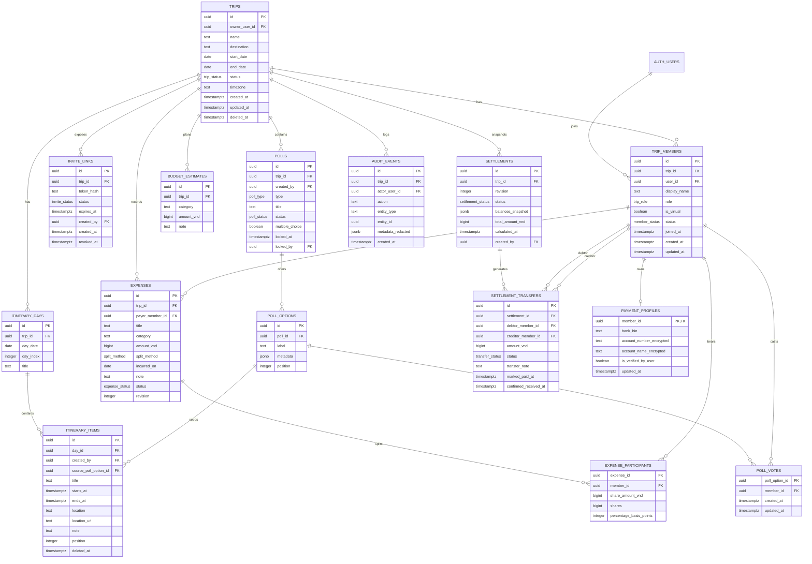

# Tripmate — Database Design

**Mục đích:** Đặc tả mô hình dữ liệu Postgres, enum, ràng buộc, index, RLS, RPC, migration và xử lý edge case cho MVP.

**Phiên bản:** 0.1

**Cập nhật lần cuối:** 2026-11-17

**Tóm tắt:** Schema dùng `uuid` cho identity/key, `bigint` cho tiền VND, snapshot và audit cho các hành động nhạy cảm. Membership là trung tâm của RLS. Virtual member được biểu diễn bằng `trip_members.user_id IS NULL` với cờ `is_virtual`; merge vào user thật phải là transaction idempotent.

## 1. Quy ước dữ liệu

| Quy ước | Quyết định |
|---|---|
| Primary key | `uuid` generated by `gen_random_uuid()`; không dùng sequential public id. |
| Time | `timestamptz` UTC; hiển thị Asia/Ho_Chi_Minh. |
| Date | `date` cho trip date/day; không lưu date trong text. |
| Money | `bigint` VND integer; tuyệt đối không `numeric`/float cho share calculation ở application layer. |
| Public code | Invite code/token random; không dùng UUID raw làm short code hiển thị. |
| Naming | `snake_case` cho DB; table số nhiều; enum lower-case; timestamp `created_at`, `updated_at`. |
| Delete | Soft delete/void cho dữ liệu nghiệp vụ; `deleted_at` nullable khi cần. |
| Audit | Actor + action + entity + metadata đã redact; không lưu bank secret/raw token. |

## 2. ERD



## 3. Enum và bảng chi tiết

```sql
create type trip_status as enum ('active', 'settling', 'completed', 'archived');
create type trip_role as enum ('owner', 'member');
create type member_status as enum ('active', 'inactive', 'pending_merge');
create type invite_status as enum ('active', 'revoked', 'expired');
create type poll_type as enum ('destination', 'date', 'custom');
create type poll_status as enum ('draft', 'open', 'locked', 'cancelled');
create type split_method as enum ('equal', 'exact', 'percentage', 'shares');
create type expense_status as enum ('active', 'voided');
create type settlement_status as enum ('open', 'needs_recalculation', 'completed', 'cancelled');
create type transfer_status as enum ('pending', 'marked_paid', 'confirmed_received', 'disputed', 'cancelled');
```

| Bảng | Cột quan trọng | Ràng buộc/index | Ghi chú |
|---|---|---|---|
| `trips` | `owner_user_id`, `name`, dates, status | `name` non-empty; `end_date >= start_date`; index owner/status | Owner membership tạo cùng transaction. |
| `trip_members` | trip/user/display/role/virtual/status | Unique `(trip_id,user_id)` khi user not null; display non-empty; index `(trip_id,status)` | Virtual member có `user_id null`, unique display không bắt buộc. |
| `invite_links` | `token_hash`, expiry/status | Index hash; chỉ store hash; không trả token sau create | Token raw chỉ xuất hiện một lần trong response/share. |
| `polls` | type/title/status/multiple | Index `(trip_id,status)`; title non-empty | Lock phải có locked_by/time. |
| `poll_options` | label/metadata/position | Unique `(poll_id,position)`; index poll | Metadata date/destination validated theo type. |
| `poll_votes` | option/member | PK `(poll_option_id,member_id)` | RPC kiểm tra option cùng poll/trip và poll open. |
| `itinerary_days` | date/index/title | Unique `(trip_id,day_index)`; optional unique date | Date-less trip dùng day_index. |
| `itinerary_items` | day/title/time/position | Index `(day_id,position)`; position non-negative | Soft delete; time theo timezone trip. |
| `budget_estimates` | category/amount | Amount ≥0; index trip/category | Không tham gia balance. |
| `expenses` | payer/amount/split/status/revision | Amount >0; index trip/status/incurred | Payer phải active member tại thời điểm tạo. |
| `expense_participants` | member/share fields | PK `(expense_id,member_id)`; exactly one representation | Lưu input basis + calculated share để audit. |
| `settlements` | revision/status/snapshot | Unique `(trip_id,revision)`; index trip/status | Snapshot immutable sau create; recalc tạo revision mới. |
| `settlement_transfers` | debtor/creditor/amount/status | Debtor ≠ creditor; amount >0; index settlement/status/recipient | Không tự động chứng minh bank payment. |
| `payment_profiles` | encrypted account fields | PK member; bank validation | RLS chặt; không select cùng trip overview. |
| `audit_events` | actor/action/entity/metadata | Index `(trip_id,created_at desc)` | Metadata allowlist, redact secret. |

## 4. RLS policy draft

SQL dưới đây là skeleton cần chạy và test trong Supabase; helper function phải dùng `security definer`, `search_path` cố định và không tạo vòng policy.

```sql
create or replace function public.is_trip_member(p_trip_id uuid)
returns boolean language sql stable security definer set search_path = public as $$
  select exists (
    select 1 from public.trip_members tm
    where tm.trip_id = p_trip_id
      and tm.user_id = auth.uid()
      and tm.status = 'active'
  );
$$;

create or replace function public.is_trip_owner(p_trip_id uuid)
returns boolean language sql stable security definer set search_path = public as $$
  select exists (
    select 1 from public.trips t
    where t.id = p_trip_id and t.owner_user_id = auth.uid()
  );
$$;

alter table public.trips enable row level security;
create policy trips_select_member on public.trips for select
  using (public.is_trip_member(id) or owner_user_id = auth.uid());
create policy trips_insert_authenticated on public.trips for insert
  with check (owner_user_id = auth.uid());
create policy trips_update_owner on public.trips for update
  using (public.is_trip_owner(id)) with check (owner_user_id = auth.uid());

alter table public.trip_members enable row level security;
create policy members_select_member on public.trip_members for select
  using (public.is_trip_member(trip_id) or user_id = auth.uid());
create policy members_insert_owner_or_self_join on public.trip_members for insert
  with check (public.is_trip_owner(trip_id) or user_id = auth.uid());
create policy members_update_owner_or_self on public.trip_members for update
  using (public.is_trip_owner(trip_id) or user_id = auth.uid());
create policy members_delete_owner on public.trip_members for delete
  using (public.is_trip_owner(trip_id));

alter table public.polls enable row level security;
create policy polls_member_read on public.polls for select
  using (public.is_trip_member(trip_id));
create policy polls_member_insert on public.polls for insert
  with check (public.is_trip_member(trip_id) and created_by = auth.uid());
create policy polls_owner_update on public.polls for update
  using (public.is_trip_owner(trip_id));

alter table public.expenses enable row level security;
create policy expenses_member_read on public.expenses for select
  using (public.is_trip_member(trip_id));
create policy expenses_member_insert on public.expenses for insert
  with check (public.is_trip_member(trip_id));
create policy expenses_creator_or_owner_update on public.expenses for update
  using (public.is_trip_owner(trip_id) or exists (
    select 1 from public.trip_members tm
    where tm.id = payer_member_id and tm.user_id = auth.uid()
  ));

alter table public.settlement_transfers enable row level security;
create policy transfers_member_read on public.settlement_transfers for select
  using (exists (
    select 1 from public.settlements s
    where s.id = settlement_id and public.is_trip_member(s.trip_id)
  ));
create policy transfers_debtor_mark_paid on public.settlement_transfers for update
  using (exists (
    select 1 from public.trip_members tm
    where tm.id = debtor_member_id and tm.user_id = auth.uid()
  ));
create policy transfers_recipient_confirm on public.settlement_transfers for update
  using (exists (
    select 1 from public.trip_members tm
    where tm.id = creditor_member_id and tm.user_id = auth.uid()
  ));

alter table public.payment_profiles enable row level security;
create policy payment_profile_self_or_transfer_context on public.payment_profiles
  for select using (
    exists (select 1 from public.trip_members tm where tm.id = member_id and tm.user_id = auth.uid())
    or exists (select 1 from public.settlement_transfers st
      join public.trip_members tm on tm.id = st.creditor_member_id
      where tm.id = member_id and exists (
        select 1 from public.settlements s where s.id = st.settlement_id and public.is_trip_member(s.trip_id)
      ))
  );
create policy payment_profile_self_write on public.payment_profiles
  for all using (exists (select 1 from public.trip_members tm where tm.id = member_id and tm.user_id = auth.uid()))
  with check (exists (select 1 from public.trip_members tm where tm.id = member_id and tm.user_id = auth.uid()));
```

### RLS kiểm thử bắt buộc

| ID | Scenario | Kết quả |
|---|---|---|
| DB-RLS-01 | User A đọc trip của User B | 0 rows/403, không leak metadata. |
| DB-RLS-02 | Member sửa poll lock | Reject; owner-only. |
| DB-RLS-03 | Member sửa expense của member khác | Reject trừ policy được chốt cho owner. |
| DB-RLS-04 | Debtor update recipient transfer khác | Reject. |
| DB-RLS-05 | Member đọc payment profile ngoài transfer context | Reject. |
| DB-RLS-06 | Anonymous session truy cập trip sau khi revoke membership | Reject ngay lần query tiếp theo. |

## 5. RPC và transaction cần có

| RPC | Input/output | Mục đích |
|---|---|---|
| `create_trip` | input trip fields; output trip + owner member | Atomic create trip/membership/first invite tùy chọn. |
| `redeem_invite` | token/display name; output membership + public trip summary | Hash token, kiểm tra expiry/revoke/limit, idempotent. |
| `merge_virtual_member` | virtual member id + authenticated user id | Merge participants/history có xác nhận, reject conflict. |
| `lock_poll` | poll id; output locked poll/result | Owner-only, transaction lock + audit. |
| `reorder_itinerary_items` | day id + ordered item ids + version | Validate quyền, update positions atomically. |
| `create_expense_with_split` | expense input + participant inputs + idempotency key | Validate split, insert expense/participants transaction. |
| `get_trip_balances` | trip id + optional settlement revision | Aggregate active expenses; output paid/share/net. |
| `create_settlement_snapshot` | trip id; output settlement/transfers | Tính deterministic balances/transfers; immutable snapshot. |
| `mark_transfer_paid` | transfer id | Debtor-only, status transition + audit. |
| `confirm_transfer_received` | transfer id | Creditor-only, status transition + audit. |
| `request_trip_deletion` | trip id | Owner-only, soft delete + retention marker. |

RPC phải giới hạn `search_path`, kiểm tra `auth.uid()`, không nhận role/trip membership từ client và trả lỗi domain không chứa SQL details.

## 6. Migration, seed và soft delete

1. Một migration nhỏ cho enum/table/index; tên theo timestamp + mô tả.
2. Không sửa migration đã chạy production; tạo migration mới.
3. Schema change backward-compatible trong một deploy nếu app rollout cần hai version.
4. Backfill có batch/transaction giới hạn; đo lock/time trước production.
5. Mỗi migration có rollback note dù Supabase migration không tự rollback hoàn hảo.

### Seed data

- Seed local có 1 owner, 3 members, 1 virtual member, 2 poll, 3 itinerary item, 5 expense và 1 settlement.
- Không dùng tên/ngân hàng thật trong seed.
- Seed deterministic để unit/integration test không phụ thuộc dữ liệu ngẫu nhiên.

### Soft delete

- `trips.deleted_at` ẩn khỏi list; không cascade hard delete ngay.
- Expense dùng `status='voided'`, giữ amount/participants cho audit.
- Itinerary item/invite có `deleted_at` hoặc status tùy bảng.
- Settlement snapshot immutable; recalculation tạo revision mới.
- Hard delete chỉ chạy bởi retention job sau policy và consent; payment/audit data cần quy tắc riêng.

## 7. Xử lý edge case dữ liệu

| Case | Schema/transaction response |
|---|---|
| Member rời nhóm còn nợ | `status=inactive`; giữ FK; không hard delete; settlement mới yêu cầu owner remap hoặc đóng thủ công. |
| Virtual member đăng nhập | Transaction update `user_id`, merge duplicate membership, remap foreign keys nếu không conflict. |
| Expense sửa sau settlement | Increment `revision`; settlement `needs_recalculation`; transfer cũ không bị xóa. |
| 100000 chia 3 | Store calculated `share_amount_vnd` integer; RPC assert sum = expense amount. |
| Concurrent invite redeem | Unique/transaction lock; một user không tạo duplicate membership. |
| Concurrent poll lock/vote | Update condition `status='open'`; một transaction thắng, transaction kia refresh. |
| Stale reorder | Check version; reject conflict, không overwrite. |
| Bank profile xóa | Transfer giữ amount/nội dung tối thiểu nhưng QR không render lại nếu thiếu profile. |

## Câu hỏi mở

1. Có cần bảng `profiles` riêng hay dùng `auth.users` metadata cho display name? Đề xuất bảng app riêng để kiểm soát privacy.
2. `trip_members.user_id` nullable có đủ cho virtual member hay cần bảng alias để merge nhiều alias?
3. Có cần lưu snapshot expense breakdown trong settlement để lịch sử không phụ thuộc expense bị void không?
4. RLS payment profile có nên thay bằng RPC trả masked fields để giảm policy phức tạp?
5. Retention job chạy bằng Supabase scheduled function hay thủ công trong MVP?
6. Có cần application-level envelope encryption cho payment profile hay provider encryption đủ cho MVP?

## Quyết định cần chốt

| Mã | Quyết định | Đề xuất mặc định |
|---|---|---|
| DEC-DB-01 | Money | `bigint` VND; JSON serialize dưới dạng string nếu cần tránh giới hạn number. |
| DEC-DB-02 | Virtual member | `trip_members.user_id null + is_virtual true`; merge bằng RPC atomic. |
| DEC-DB-03 | Settlement | Snapshot immutable; sửa expense tạo revision mới. |
| DEC-DB-04 | RLS | Membership-centered, deny-by-default; mutation quan trọng qua RPC/server action. |
| DEC-DB-05 | Payment profile | Chỉ trả masked/required fields trong transfer context; raw encrypted value không đi vào overview. |
| DEC-DB-06 | Delete | Soft delete/void ở nghiệp vụ; hard delete chỉ sau retention policy. |
