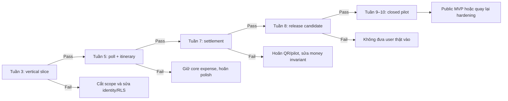

# Tripmate — Roadmap, Risk và Launch Plan

**Mục đích:** Lập lịch xây dựng MVP 8–10 tuần, quản lý rủi ro, chạy closed pilot và chuẩn bị tăng trưởng không tốn tiền.

**Phiên bản:** 0.1

**Cập nhật lần cuối:** 2026-11-17

**Tóm tắt:** Solo developer xây MVP trong 8 tuần kỹ thuật, dành tuần 9–10 cho pilot 10–20 nhóm và sửa lỗi. Mỗi tuần có một mốc kiểm tra có thể dừng hoặc giảm scope. Public launch chỉ xảy ra khi core money/RLS/join ổn định, không chỉ khi UI đã đẹp.

## 1. Lộ trình 10 tuần

| Tuần | Mục tiêu | Deliverable | Mốc kiểm tra |
|---:|---|---|---|
| 1 | Foundation | React/Vite/TypeScript, Supabase project/local, migrations skeleton, anonymous auth, Docker/CI | Tạo session, lint/typecheck/build/test pass. |
| 2 | Vertical slice A | Create trip, owner membership, invite link/preview | Creator tạo trip và mở link trên browser khác. |
| 3 | Vertical slice B | Redeem invite, member list, equal expense, balance cơ bản | E2E create → join → expense → balance pass. |
| 4 | Poll | Destination/date poll, vote, result, lock, RLS | 3 member vote; lock owner-only; reload nhất quán. |
| 5 | Itinerary | Day/item, reorder, source poll, overview summary | Nhóm chốt kèo và xem lịch trình trên mobile. |
| 6 | Expense đầy đủ | Exact/percentage/shares, budget estimate, edit/void, rounding | Test ALG/TC expense pass; no invariant drift. |
| 7 | Settlement | Balance snapshot, greedy transfers, states, breakdown | 16 algorithm cases + transfer state E2E pass. |
| 8 | VietQR + hardening | QR/fallback, PWA, realtime fallback, RLS/security, Sentry | Release candidate 0 P0/P1 known; staging deploy. |
| 9 | Closed pilot start | 5–10 nhóm, observe sessions, support channel, feedback | Tỷ lệ join/activation và lỗi thực tế được ghi. |
| 10 | Closed pilot finish | 10–20 nhóm lũy kế, fix top issues, launch decision | Go/no-go public; backlog post-MVP được phân loại. |

### Mốc go/no-go

## 2. Bảng rủi ro

| ID | Rủi ro | Xác suất | Tác động | Trigger | Giảm thiểu | Owner/điểm kiểm |
|---|---|---|---|---|---|---|
| LR-01 | Solo dev trễ vì scope | Cao | Cao | Tuần 4 còn nhiều Must chưa chạy | Giữ vertical slice; hoãn budget/Google/QR image nếu cần | Review cuối mỗi tuần |
| LR-02 | Tính tiền sai | Trung bình | Rất cao | Invariant fail hoặc user sửa tay | Integer arithmetic, test fixtures, no silent rounding | Trước tuần 7 |
| LR-03 | RLS lộ trip | Trung bình | Rất cao | Cross-trip test đọc được row | Deny-by-default, test 2 user/2 trip, review policy | Mỗi migration |
| LR-04 | Anonymous session mất | Cao | Cao | Pilot báo mất trip sau đổi máy | Prompt Google sau value, recovery copy, export cân nhắc | Trước pilot |
| LR-05 | Invite abuse | Trung bình | Cao | Spike redeem/guess | Hash token, TTL/revoke, rate limit, limits | Trước pilot |
| LR-06 | VietQR sai/không quét | Trung bình | Cao | QR scan fail | Provider/library đã test, fallback copy, test bank sample | Tuần 8 |
| LR-07 | Free tier bị vượt | Trung bình | Cao | Quota >70% hoặc latency tăng | Pagination, realtime scoped, no receipt storage, alert | Hằng tuần |
| LR-08 | User không dùng app ngoài chat | Cao | Trung bình | Invite join cao nhưng activation thấp | Deep link context, one-tap actions, share summary | Tuần 9 |
| LR-09 | Scope privacy/retention chưa rõ | Trung bình | Cao | User hỏi xóa/bank data | Privacy copy, no raw logs, manual deletion runbook | Trước public |
| LR-10 | Realtime stale/conflict | Trung bình | Trung bình | Dữ liệu khác giữa 2 browser | Invalidate/refetch, version check, stale badge | Tuần 8 |
| LR-11 | Không tuyển được nhóm pilot | Trung bình | Cao | Tuần 8 chưa có danh sách >10 nhóm | Tuyển qua network cá nhân, community, incentive phi tiền | Bắt đầu tuần 6 |
| LR-12 | QR/payment tạo hiểu nhầm app xác nhận tiền | Thấp | Cao | User báo “đã chuyển” nhưng chưa nhận | Ngôn ngữ trạng thái tách biệt, recipient confirmation | UX/QA gate |

## 3. Closed pilot với 10–20 nhóm

### Tuyển nhóm

Mục tiêu tuyển 10–20 nhóm, mỗi nhóm 3–8 người, ưu tiên có một chuyến thật trong 2–4 tuần. Cơ cấu:

- 6–10 nhóm bạn đi cuối tuần/đi biển/Đà Lạt.
- 2–4 nhóm đồng nghiệp hoặc team nhỏ.
- 2–4 nhóm gia đình/nhóm có một người thường trả tiền trước.

Không tuyển toàn bộ từ người quen trực tiếp; cần ít nhất 20–30% người chưa từng nghe chi tiết về sản phẩm để tránh bias hướng dẫn.

### Cách chạy pilot

1. Gửi một câu giới thiệu và invite demo; không tổ chức training dài.
2. Đề nghị nhóm tự tạo trip, mời mọi người, thêm ít nhất 3 expense và thử settlement.
3. Có một kênh hỗ trợ riêng để ghi screenshot/error, không yêu cầu gửi dữ liệu ngân hàng.
4. Thu event funnel và phỏng vấn 15 phút sau khi nhóm hoàn tất hoặc bỏ cuộc.
5. Không sửa dữ liệu thay người dùng trừ khi cần khôi phục test; mọi hỗ trợ ghi lại để phân biệt product issue và user error.

### Câu hỏi khảo sát

| Nhóm | Câu hỏi |
|---|---|
| Onboarding | Bạn hiểu Tripmate dùng để làm gì sau khi mở link không? Bước nào khiến bạn dừng? |
| Join | Bạn có thấy yên tâm khi join không cần email không? Điều gì còn thiếu để tin link? |
| Planning | Poll/itinerary thay thế được bao nhiêu tin nhắn/spreadsheet? Phần nào vẫn quay lại chat? |
| Expense | Thêm khoản chi có nhanh đủ không? Bạn có hiểu ai đang chịu phần? |
| Settlement | Bạn tin số tiền phải trả/nhận ở mức nào (1–5)? Bạn cần xem thêm gì? |
| QR/privacy | Bạn có sẵn sàng dùng QR không? Thông tin nào bạn không muốn lưu? |
| Value | Tính năng nào bạn sẽ dùng lại trong chuyến sau? Tính năng nào thừa? |
| Trust | Có khoảnh khắc nào app làm bạn sợ mất dữ liệu hoặc tính sai tiền không? |
| Recommendation | Bạn có gửi Tripmate cho nhóm khác không? Vì sao? |

### Tiêu chí pilot thành công

- ≥60% invite open hoàn tất join.
- ≥50% nhóm có ít nhất 3 expense.
- ≥30% nhóm hoàn tất settlement hoặc xác định rõ vì sao chưa hoàn tất.
- Không có cross-trip data leak, mất expense, hoặc settlement invariant fail.
- ≥70% người trả lời hiểu khác biệt giữa marked paid và confirmed received.
- Ít nhất 5 nhóm tự chia sẻ lại link/summary mà không được nhắc trực tiếp.

## 4. Launch và tăng trưởng không tốn tiền

### Kênh

| Kênh | Cách làm | Nội dung nên thử | Chỉ số |
|---|---|---|---|
| Facebook travel groups | Chia sẻ case cụ thể, xin feedback trước khi quảng bá | “Nhóm 6 người chia 17 hóa đơn bằng mấy lần chuyển?” | Link open, join, feedback qualified |
| Reddit/community | Post build-in-public hoặc câu hỏi workflow | So sánh chat + sheet với một trip workspace | Referral, comment quality |
| TikTok/Reels | Video 20–40 giây quay luồng mobile | Từ hóa đơn 600k đến 2 transfer | View-to-link, invite creation |
| Network cá nhân | Mỗi nhóm pilot mời một nhóm khác | Share card sau chuyến đi | Referral code, repeat trip |
| SEO nhẹ | Landing giải quyết truy vấn “chia tiền đi du lịch nhóm” | Hướng dẫn cách chia bill VND | Organic visit → create trip |

### Cơ chế lan truyền tự nhiên

- Invite link là artifact tự nhiên của việc dùng app, không phải spam referral.
- Summary sau trip có nút “Tạo chuyến đi tương tự”, không gắn quảng cáo.
- Share message nói rõ tên trip và lý do người nhận cần vào, không gửi raw financial data.
- Không thưởng tiền hoặc tạo leaderboard khiến người dùng gửi link không liên quan.

## 5. Analytics tối giản và quyền riêng tư

### Event allowlist

| Event | Properties được phép | Không gửi |
|---|---|---|
| `trip_created` | anonymous installation/session cohort, source, has_date, has_destination | trip name, destination text nếu nhạy cảm, user name |
| `invite_opened` | invite version, device class, success/failure reason | raw token, URL đầy đủ |
| `member_joined` | trip size bucket, time bucket | display name, trip id công khai |
| `poll_locked` | poll type, option count | option labels, voter names |
| `expense_created` | split method, participant count bucket | title, note, exact amount |
| `settlement_viewed` | debtor/creditor count bucket | exact balances, account details |
| `transfer_status_changed` | status transition, time bucket | account number, addInfo |
| `trip_completed` | duration bucket, member count bucket, expense count bucket | raw trip data |

Analytics phải có opt-out/notice phù hợp, retention ngắn trong pilot và không dùng làm security/audit source.

## 6. Sau MVP

| Hướng | Điều kiện bắt đầu | Spike đầu tiên | Không bắt đầu nếu |
|---|---|---|---|
| Gợi ý AI itinerary | ≥30% nhóm dùng itinerary và có câu hỏi lặp | Generate draft từ điểm đến/ngày, user phải approve mọi item | Chưa rõ privacy/prompt data boundary. |
| OCR hóa đơn | Người dùng thường chụp receipt và manual entry là top pain | OCR on-device/provider, user review trước save | Chưa có receipt retention/RLS/cost budget. |
| Đa tiền tệ | Có nhóm quốc tế hoặc >10% feedback yêu cầu | Currency per expense + locked FX snapshot | Settlement VND chưa ổn định. |
| Affiliate | Có traffic/intent rõ và đối tác đáng tin | Một placement có label, không can thiệp vote | Chưa có privacy/quality policy. |
| Bank/payment integration | Nhu cầu xác nhận payment mạnh và có legal review | Provider sandbox + reconciliation design | Chưa có threat model và support capability. |

## Câu hỏi mở

1. MVP public ra sau tuần 10 hay chỉ phát hành invite-only lâu hơn?
2. Pilot có cần incentive như miễn phí một tính năng future hay chỉ cảm ơn/ghi nhận contributor?
3. Có thể thu consent phỏng vấn/screenshot từ nhóm thật như thế nào mà không lưu dữ liệu tài chính?
4. Kênh tăng trưởng ưu tiên Facebook group, TikTok hay network cá nhân?
5. Ngưỡng quota/cost nào sẽ tự động dừng acquisition?
6. Có cần status page hoặc support email trước public launch không?

## Quyết định cần chốt

| Mã | Quyết định | Đề xuất mặc định |
|---|---|---|
| DEC-LAUNCH-01 | Timeline | 8 tuần build + 2 tuần closed pilot; không rút pilot chỉ để launch sớm. |
| DEC-LAUNCH-02 | Pilot cohort | 10–20 nhóm, có nhóm bạn/đồng nghiệp/gia đình; ưu tiên chuyến thật. |
| DEC-LAUNCH-03 | Acquisition | Network + community content trước; chưa chạy paid ads. |
| DEC-LAUNCH-04 | Analytics | Event allowlist aggregate, không exact financial data. |
| DEC-LAUNCH-05 | Post-MVP order | Reliability/retention → OCR/AI discovery → multi-currency/affiliate theo evidence. |
